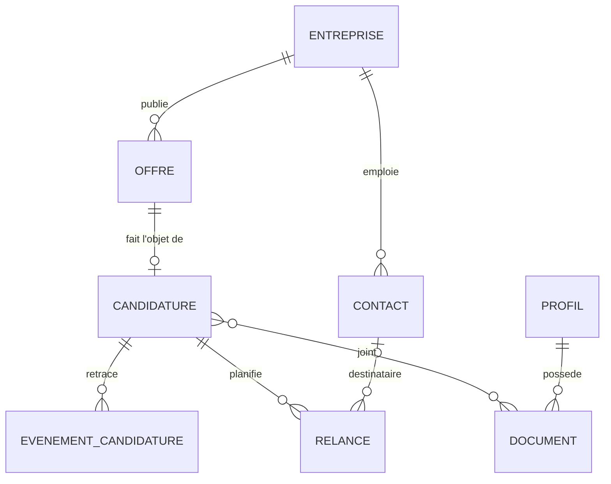

# ADR-0001 : cadrage de l'architecture de la V1

- **Statut** : acceptée ; D13 remplacée en partie par l'[ADR-0002](0002-budget-nul.md) (signature de code) ; D2 remplacée en partie par l'[ADR-0003](0003-hote-interface-webview2.md) (hôte de l'interface)
- **Date** : 2026-11-13

## Contexte

Sollicito aidera un particulier à mener sa recherche d'emploi en Belgique : suivre ses candidatures, gérer ses relances, importer des offres, avec une IA facultative. Les données en jeu sont sensibles (parcours, CV, prétentions salariales, refus) et appartiennent à une seule personne.

Exigences retenues :

- une vraie base de données, avec au moins cinq entités ;
- au moins une Web API en .NET (C#) ;
- un développement mené en Scrum ;
- un logiciel libre, lisible par tous, sans aucun secret ni aucune donnée réelle dans son dépôt ;
- une application fiable, dont le cœur fonctionne sans réseau ni IA, et qui ne perd jamais les données de l'utilisateur.

Ce premier ADR regroupe les décisions de cadrage. Toute révision, et toute réponse à un point de la section « À vérifier », passera par un nouvel ADR, qui remplacera le point concerné.

## Décisions

### D1. Une application de bureau, locale et mono-utilisateur

Sollicito sera une application de bureau pour Windows, installée par l'utilisateur, avec toutes ses données sur sa machine. Pas de mode serveur, pas d'instance hébergée : l'auteur ne détient les données de personne.

### D2. Une Web API ASP.NET Core en local, une interface React dans Photino.NET

L'application lance une Web API ASP.NET Core qui n'écoute que sur 127.0.0.1. L'interface, écrite en React, s'affiche dans une fenêtre Photino.NET, qui s'appuie sur WebView2 sous Windows, et appelle cette API comme elle appellerait un serveur. L'API reste ainsi une vraie Web API, testable seule (OpenAPI), découplée de l'interface. La maintenance de Photino.NET reste à vérifier (voir « À vérifier »).

### D3. SQLite, par Entity Framework Core

Un seul fichier de base, local, sans serveur à installer. Le schéma évolue par migrations EF Core versionnées dans le dépôt.

### D4. Un monolithe modulaire en Clean Architecture

Un seul processus, découpé en modules aux frontières explicites : **Candidatures**, **Offres et connecteurs**, **Relances**, **Profil**, **IA**. Le domaine ne dépend d'aucune infrastructure (base, réseau, IA). L'ingestion des offres tourne comme tâche de fond (`BackgroundService`) dans le même processus. Pas de microservices ni de Kubernetes : un logiciel installé chez un particulier n'en tire aucun bénéfice, et chaque processus de plus serait une source de panne.

### D5. Le modèle de domaine de la V1

Huit entités : **Profil**, **Entreprise**, **Contact**, **Offre**, **Candidature**, **Événement de candidature**, **Relance**, **Document**. Esquisse, à affiner au premier sprint :

Une offre garde sa source et son identifiant externe : le couple (source, identifiant externe) dédoublonne les offres d'une même source. Le rapprochement d'une même offre vue sur deux sources, et le cas d'une offre collée sans identifiant, seront précisés au premier sprint. Les sources et leurs réglages relèvent de la configuration, pas du domaine.

### D6. Les offres arrivent par des connecteurs, derrière une interface unique

Une seule interface, le connecteur d'offres (un port, au sens de l'architecture hexagonale), et un adaptateur par source. Chaque connecteur convertit vers le modèle d'Offre commun, puis le cœur dédoublonne (D5). Ajouter une source ne touche pas au domaine.

- **V1** : le jeu de données ouvert des offres du Forem, publié sur la plateforme ODWB, et l'import manuel : texte ou adresse d'une offre collés, fichier CSV.
- **V2** : l'API du VDAB, et le connecteur MCP d'Indeed si son usage s'ouvre aux applications tierces (il est aujourd'hui en bêta et réservé au connecteur Claude).
- **Règle** : seules sont intégrées des sources dont les conditions d'utilisation ou la licence autorisent la réutilisation. Aucune collecte automatisée sur un site qui ne la permet pas.

### D7. Une IA facultative, fournie par l'utilisateur

Le module IA passe par une interface de fournisseur : une clé d'API apportée par l'utilisateur (Claude, OpenAI, Mistral…) ou un modèle local (Ollama). Sans IA configurée, toutes les autres fonctions marchent.

- **V1** : extraction des informations d'une offre collée, avec une sortie JSON validée contre un schéma avant d'entrer en base ; brouillon de relance.
- **V2** : score de correspondance entre une offre et le profil, aide aux CV et aux lettres, construction du profil. L'aide aux CV demandera ses propres garde-fous : ne jamais inventer une expérience ni une compétence.
- **Une clé, une adresse** : chaque clé est liée à l'adresse officielle de son fournisseur, fixée dans le code et appelée en HTTPS. Une adresse réglable (Ollama, service compatible) ne reçoit jamais la clé d'un autre fournisseur, et la modifier efface la clé enregistrée.

### D8. L'humain valide chaque envoi

Sollicito n'envoie jamais rien à la place de l'utilisateur. En V1, une relance est une échéance, un rappel et un brouillon que l'application ouvre dans la messagerie de l'utilisateur, par un lien `mailto` qu'elle construit à partir de champs validés.

En V2, un connecteur Gmail ou Outlook (OAuth) pourra déposer le brouillon dans la boîte de l'utilisateur, sans l'envoyer. Les permissions OAuth de ces services débordent probablement ce besoin : chez Outlook, la permission qui crée un brouillon permet aussi de lire les messages ; chez Gmail, la plus étroite permet aussi l'envoi. « Sans envoi » et « sans lecture » reposeraient alors sur le code, pas sur la permission. Ce connecteur aura donc son propre ADR, qui vérifiera ce point et pèsera ce risque. La lecture de la boîte mail reste hors périmètre.

### D9. La sécurité de l'API locale et de la fenêtre

Menaces visées : une page ouverte dans un navigateur qui appelle l'API (requête intersite, rebinding DNS) ; un autre programme ou un autre compte Windows du même PC ; le contenu des offres, qui n'est pas fiable.

**API locale**

- Écoute sur 127.0.0.1 uniquement, jamais sur une interface réseau.
- Un jeton aléatoire d'au moins 256 bits, généré à chaque lancement et remis à l'interface par le canal interne de la fenêtre, jamais par une route HTTP, un fichier ou la ligne de commande. Il circule dans un en-tête dédié, jamais dans un cookie ni dans une adresse. Toute route l'exige, documentation OpenAPI comprise, en développement aussi.
- Le serveur refuse lui-même toute requête dont l'en-tête `Origin` n'est pas celui de l'interface (origine `null` comprise) et tout en-tête `Host` inattendu. Aucune politique CORS n'ouvre l'API à une autre origine : CORS assouplit la règle de même origine, il ne protège pas le serveur.
- Une éventuelle connexion WebSocket vérifie aussi l'origine, car CORS ne s'y applique pas.

**Fenêtre**

- La fenêtre n'affiche que l'interface locale : navigation et nouvelles fenêtres vers une autre origine bloquées, permissions du navigateur (caméra, micro…) refusées, outils de développement et menu contextuel coupés dans la version publiée.
- Une politique de sécurité du contenu (CSP) stricte interdit scripts, connexions et images venus d'ailleurs. Elle empêche aussi une sortie d'IA de faire fuiter des données par une image distante.
- Un lien issu d'une offre ou de l'IA ne s'ouvre que dans le navigateur par défaut, et seulement en `http` ou `https`.

**Contenu non fiable**

- Les offres s'affichent échappées, sans HTML brut ; la sortie de l'IA s'affiche en texte brut.
- Le texte d'une offre est transmis à l'IA comme donnée à analyser, jamais comme instruction. L'IA n'a aucun outil capable d'agir (envoyer, supprimer, appeler une adresse), et sa sortie est validée avant d'être présentée à l'utilisateur.
- La récupération d'une adresse collée n'accepte que `http` et `https`. Elle refuse toute destination de la machine ou d'un réseau privé, vérifiée sur l'adresse IP réellement jointe et à chaque redirection, borne la taille et la durée, et n'envoie ni cookie ni identifiants Windows.

**Secrets et journaux**

- Les clés d'API d'IA sont chiffrées par l'API Data Protection d'ASP.NET Core, dont le trousseau est protégé explicitement par DPAPI, en portée utilisateur et jamais machine. DPAPI protège des autres comptes Windows et d'une lecture du disque hors ligne, pas d'un programme lancé sous le compte de l'utilisateur.
- Les journaux ne contiennent ni le jeton, ni les clés, ni le contenu des offres, des candidatures ou du profil.

Un modèle de menaces détaillera ces points dans `docs/`.

### D10. Données, sauvegarde et portabilité

- Toutes les données (base, sauvegardes, trousseau Data Protection, profil WebView2) vivent dans un dossier propre à Sollicito, sous le profil de l'utilisateur (`%LOCALAPPDATA%\Sollicito`), hors du dossier d'installation et hors du dépôt, développement compris.
- Une mise à jour ne touche jamais aux données. La désinstallation les garde par défaut et propose de les effacer.
- Sauvegarde automatique de la base, avec rotation (par exemple les sept dernières), dans un dossier que l'utilisateur peut placer sur un autre support : une copie sur le même disque ne protège pas de sa panne. L'application prévient que ces copies ne sont pas chiffrées ; un chiffrement par mot de passe est à étudier.
- Export complet en JSON ou CSV, rechargeable par import. Les clés d'IA sont rangées hors de la base : ni les sauvegardes ni les exports ne les emportent, et l'utilisateur les ressaisit après une restauration sur une autre machine, où DPAPI ne pourrait pas les déchiffrer.
- L'import est une entrée non fiable : validé contre un schéma, borné en taille, précédé d'une sauvegarde, sans effet sur les réglages, IA comprise.
- L'export CSV neutralise les cellules qui commencent par `=`, `+`, `-` ou `@`, pour qu'un tableur ne les exécute pas comme des formules.

En tout local, la perte du disque est le premier risque pour l'utilisateur. L'export permet aussi de reprendre ses données dans un autre outil, dans l'esprit du droit à la portabilité.

### D11. La fiabilité se prouve par les tests

- Tests unitaires xUnit sur le domaine.
- Tests d'intégration de l'API sur une vraie base SQLite.
- Tests de contrat pour chaque connecteur, sur des réponses synthétiques (fictives), jamais sur des données réelles.
- Une intégration continue sur GitHub Actions qui bloque la fusion si un test échoue.

### D12. La documentation vit avec le code

Dans `docs/` : les diagrammes UML (classes, séquences, cas d'utilisation), les vues C4 (contexte, conteneurs, composants), les ADR et le modèle de menaces, écrits en Mermaid ou PlantUML et versionnés avec le code.

### D13. Distribution

Un installeur Inno Setup publié sur GitHub Releases, avec l'empreinte SHA-256 et une attestation de provenance GitHub de chaque binaire : l'empreinte prouve l'intégrité du téléchargement, l'attestation prouve que le binaire a été construit par l'intégration continue du dépôt. Versions gérées par release-please. Pas de mise à jour automatique en V1 : l'utilisateur installe la nouvelle version depuis la page des versions.

Pas de signature de code en V1. SmartScreen affichera un avertissement à chaque nouvelle version, tant qu'elle n'a pas acquis de réputation, et Smart App Control, s'il est actif sous Windows 11, bloquera l'installeur. Le guide d'installation l'expliquera.

### D14. Licence AGPL-3.0

Le code est publié sous AGPL-3.0 : chacun peut le lire, l'utiliser, le modifier et le redistribuer, mais personne ne peut en distribuer une version fermée, ni proposer une version modifiée comme service en ligne sans en offrir le code source à ses utilisateurs.

### D15. Méthode

Scrum, en sprints de deux semaines. Une user story par issue GitHub, une branche par issue, une pull request pour fusionner. Le backlog sera tenu dans GitHub Projects.

## Alternatives écartées

- **Service en ligne hébergé** : l'auteur deviendrait responsable du traitement des données de tous les utilisateurs. Écarté.
- **.NET MAUI Blazor Hybrid** : l'interface appellerait le code .NET directement, sans Web API.
- **Electron** : un environnement Node et Chromium complet embarqué, lourd pour une application de suivi.
- **SQL Server ou PostgreSQL** : un serveur de base à installer et à maintenir chez un particulier.
- **Microservices et Kubernetes** : une complexité d'exploitation sans bénéfice pour un seul utilisateur sur une seule machine.
- **Paquet MSIX en V1** : un paquet MSIX doit être signé pour s'installer, ce que la V1 ne prévoit pas.
- **Collecte automatisée sur les grands sites d'emploi** : contraire à la règle de D6.

## Conséquences

- **Positives** : aucune donnée hébergée par un tiers, un cœur utilisable sans réseau, indépendant des sources et des fournisseurs d'IA, une architecture qui se vérifie par les tests.
- **Négatives** : Windows uniquement au départ ; pas de synchronisation entre plusieurs ordinateurs ; l'utilisateur garde la responsabilité de son poste, d'où les sauvegardes et l'export de D10 ; des clés d'IA à ressaisir après une restauration sur une autre machine ; l'avertissement SmartScreen et le blocage par Smart App Control tant que l'installeur n'est pas signé.

## À vérifier

Points relevés le 2026-11-13, à régler par un nouvel ADR avant de bâtir dessus :

- **Photino.NET** : le rendu par WebView2 est confirmé, mais la maintenance est faible (dernière version 4.0.16 du 23/01/2025, dernier commit du 26/03/2026). Vérifier qu'il permet de bloquer la navigation et les nouvelles fenêtres (D9) et qu'il suit les versions de .NET supportées ; sinon, contribuer au projet ou choisir un autre hôte WebView2. À décider avant le premier sprint.
- **Import par adresse** : récupérer la page d'une adresse collée à la demande de l'utilisateur, ou seulement auprès des sources dont les conditions le permettent, l'utilisateur collant le texte dans les autres cas ? D'ici là, la règle de D6 s'applique.
- **Licence des données du Forem** : le jeu de données d'ODWB est annoncé sous licence CC BY-SA 4.0. Ce qu'imposent l'attribution et le partage à l'identique, notamment pour les données qui sortent dans un export, reste à préciser.
- **API du VDAB** : inscription gratuite d'après son portail développeur ; conditions de réutilisation à lire.
- **Connecteur MCP d'Indeed** : en bêta et réservé au connecteur Claude d'après sa documentation (mise à jour du 12/09/2026), donc inutilisable par Sollicito à ce jour.
- **Nom** : vérifier que « Sollicito » ne pose pas de problème de marque.

## Sources

Consultées le 2026-11-13 :

- Le Forem, données ouvertes : <https://www.leforem.be/open-data.html>
- ODWB, jeu de données des offres d'emploi du Forem : <https://www.odwb.be/explore/dataset/offres-d-emploi-forem/>
- VDAB, portail développeur : <https://developer.vdab.be/openservices>
- Indeed, documentation du serveur MCP : <https://docs.indeed.com/mcp>
- Photino.NET, dépôt du projet : <https://github.com/tryphotino/photino.NET>
