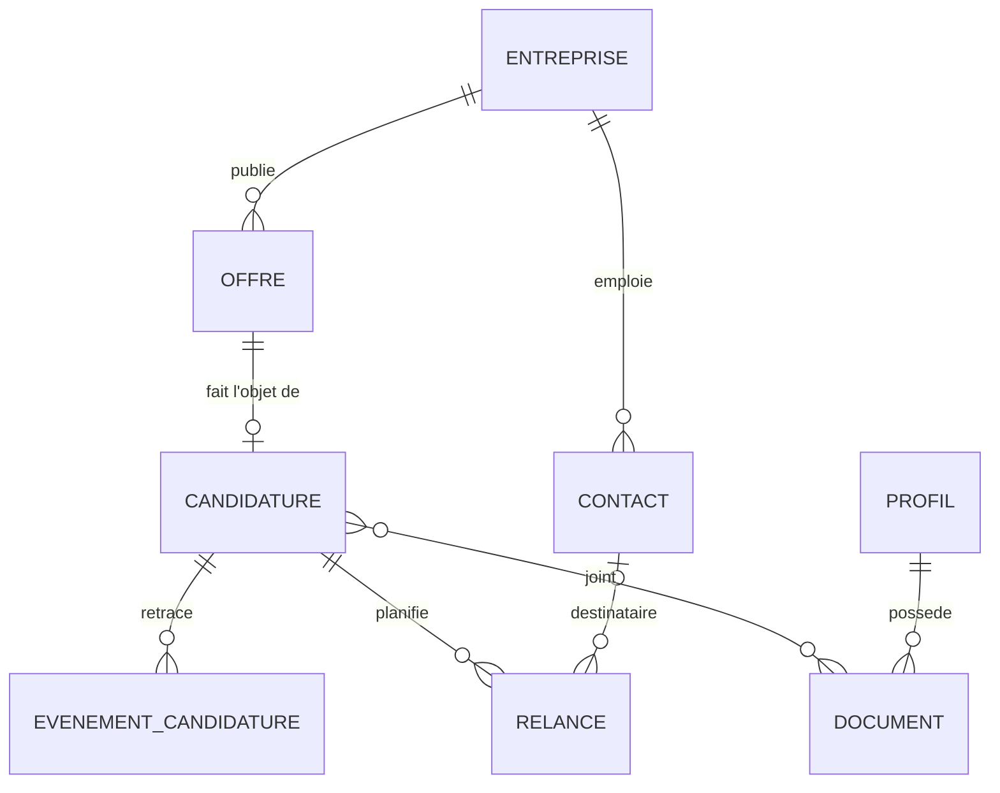

# ADR-0001 : cadrage de l'architecture de la V1

- **Statut** : acceptée
- **Date** : 2026-11-13

## Contexte

Sollicito aidera un particulier à mener sa recherche d'emploi en Belgique : suivre ses candidatures, gérer ses relances, importer des offres, avec une IA facultative. Les données en jeu sont sensibles (parcours, CV, prétentions salariales, refus) et appartiennent à une seule personne.

Contraintes posées au départ :

- une vraie base de données derrière l'application, avec au moins cinq entités ;
- au moins une Web API en .NET (C#) ;
- un développement mené en Scrum ;
- un logiciel libre, lisible par n'importe qui, qui ne doit contenir aucun secret ni aucune donnée réelle ;
- une application fiable : elle doit fonctionner sans réseau ni IA et ne jamais perdre les données de l'utilisateur.

Ce premier ADR regroupe les décisions de cadrage. Une décision révisée plus tard aura son propre ADR, qui remplacera le point concerné.

## Décisions

### D1. Une application de bureau, locale et mono-utilisateur

Sollicito sera une application de bureau pour Windows, installée par l'utilisateur, avec toutes ses données sur sa machine. Pas de mode serveur, pas d'instance hébergée : l'auteur ne détient les données de personne.

### D2. Une Web API ASP.NET Core en local, une interface React dans Photino.NET

L'application lance une Web API ASP.NET Core qui n'écoute que sur 127.0.0.1. L'interface, écrite en React, s'affiche dans une fenêtre Photino.NET et appelle cette API comme elle appellerait un serveur. L'API reste ainsi une vraie Web API, testable seule (OpenAPI), découplée de l'interface.

### D3. SQLite, par Entity Framework Core

Un seul fichier de base, local, sans serveur à installer. Le schéma évolue par migrations EF Core versionnées dans le dépôt.

### D4. Un monolithe modulaire en Clean Architecture

Un seul processus, découpé en modules aux frontières explicites : **Candidatures**, **Offres et sources**, **Relances**, **Profil**, **IA**. Le domaine ne dépend d'aucune infrastructure (base, réseau, IA). L'ingestion des offres tourne comme tâche de fond (`BackgroundService`) dans le même processus. Pas de microservices ni de Kubernetes : un logiciel installé chez un particulier n'en tire aucun bénéfice, et chaque processus de plus serait une source de panne.

### D5. Le modèle de domaine de la V1

Huit entités : **Profil**, **Entreprise**, **Contact**, **Offre**, **Candidature**, **Événement de candidature**, **Relance**, **Document**. Esquisse, à affiner au premier sprint :

Une offre garde sa source et son identifiant externe, qui servent au dédoublonnage. Les sources et leurs réglages relèvent de la configuration, pas du domaine.

### D6. Les sources d'offres derrière une interface unique

Une seule interface, « source d'offres » (un port, au sens de l'architecture hexagonale), et un adaptateur par source. Chaque adaptateur convertit vers le modèle d'Offre commun, et le cœur dédoublonne par le couple (source, identifiant externe). Ajouter une source ne touche pas au domaine.

- **V1** : le jeu de données ouvert des offres du Forem, publié sur la plateforme ODWB, et l'import manuel (texte ou adresse collés, fichier CSV).
- **Plus tard** : l'API du VDAB, puis des connecteurs MCP, comme celui que publie Indeed pour les assistants IA, une fois vérifié qu'une application tierce peut l'utiliser.
- **Règle** : seules sont intégrées des sources dont les conditions d'utilisation ou la licence autorisent la réutilisation. Pas de collecte automatisée sur un site qui ne la permet pas.

### D7. Une IA facultative, fournie par l'utilisateur

Le module IA passe par une interface de fournisseur : une clé d'API apportée par l'utilisateur (Claude, OpenAI, Mistral…) ou un modèle local (Ollama). Sans IA configurée, toutes les autres fonctions marchent.

- **V1** : extraction des informations d'une offre collée, avec une sortie JSON validée contre un schéma avant d'entrer en base ; brouillon de relance.
- **Plus tard** : score de correspondance entre une offre et le profil, aide aux CV et aux lettres, construction du profil. L'aide aux CV demandera ses propres garde-fous : ne jamais inventer une expérience ni une compétence.

### D8. L'humain valide chaque envoi

Sollicito n'envoie jamais rien à la place de l'utilisateur. En V1, une relance est une échéance, un rappel et un brouillon que l'application ouvre dans la messagerie de l'utilisateur. Plus tard, un connecteur Gmail ou Outlook (OAuth) pourra déposer le brouillon dans sa boîte, sans jamais l'envoyer. La lecture de la boîte mail, par exemple pour détecter les réponses, est hors périmètre : elle demanderait un accès à tous les messages.

### D9. La sécurité de l'API locale et des données

Une API qui écoute sur la machine peut être appelée par n'importe quelle page ouverte dans un navigateur (requêtes intersites, rebinding DNS). D'où :

- l'écoute sur 127.0.0.1 uniquement, jamais sur une interface réseau ;
- un jeton aléatoire, généré à chaque lancement et transmis à la seule interface embarquée ; toute requête sans ce jeton est refusée ;
- le contrôle de l'en-tête `Host` et une liste blanche d'origines (CORS) ;
- des clés d'API d'IA chiffrées par l'API Data Protection d'ASP.NET Core, adossée à DPAPI sous Windows ; jamais en clair, ni sur disque ni dans les journaux ;
- le contenu des offres traité comme non fiable : affiché échappé, sans HTML brut ; transmis à l'IA comme donnée à analyser, jamais comme instruction. L'IA n'a aucun outil capable d'agir (envoyer, supprimer, appeler une adresse) : sa sortie est validée puis présentée à l'utilisateur.

Un modèle de menaces détaillera ces points dans `docs/`.

### D10. Sauvegarde et portabilité

Sauvegarde automatique du fichier de base, avec rotation (par exemple les sept dernières), et export complet en JSON ou CSV, rechargeable par import. En tout local, la perte du disque est le premier risque pour l'utilisateur ; l'export répond aussi au droit à la portabilité des données.

### D11. La fiabilité se prouve par les tests

- Tests unitaires xUnit sur le domaine.
- Tests d'intégration de l'API sur une vraie base SQLite.
- Tests de contrat pour chaque source d'offres, sur des réponses synthétiques ou anonymisées, jamais sur des données personnelles réelles.
- Une intégration continue sur GitHub Actions qui bloque la fusion si un test échoue.

### D12. La documentation vit avec le code

Dans `docs/` : les diagrammes UML (classes, séquences, cas d'utilisation), les vues C4 (contexte, conteneurs, composants), les ADR et le modèle de menaces, écrits en Mermaid ou PlantUML et versionnés avec le code.

### D13. Distribution

Un installeur Windows (Inno Setup ou MSIX, à trancher) publié sur GitHub Releases, avec ses empreintes SHA-256. Versions gérées par release-please. Pas de signature de code en V1 : Windows SmartScreen affichera un avertissement au premier lancement, ce que le guide d'installation expliquera.

### D14. Licence AGPL-3.0

Le code est publié sous AGPL-3.0 : tout le monde peut le lire, l'utiliser et le modifier, mais personne ne peut en tirer un service fermé sans publier ses modifications.

### D15. Méthode

Scrum, en sprints de deux semaines. Une user story par issue GitHub, une branche par issue, une pull request pour fusionner. Le backlog est public.

## Alternatives écartées

- **Service en ligne hébergé** : l'auteur deviendrait responsable du traitement des données de tous les utilisateurs. Écarté pour la V1.
- **.NET MAUI Blazor Hybrid** : l'interface appellerait le code .NET directement, sans Web API.
- **Electron** : un environnement Node et Chromium complet embarqué, lourd pour une application de suivi.
- **SQL Server ou PostgreSQL** : un serveur de base à installer et à maintenir chez un particulier.
- **Microservices et Kubernetes** : une complexité d'exploitation sans bénéfice pour un seul utilisateur sur une seule machine.
- **Collecte automatisée sur les grands sites d'emploi** : contraire à la règle de D6.

## Conséquences

- **Positives** : aucune donnée hébergée par un tiers, une application utilisable sans réseau, un cœur indépendant des sources et des fournisseurs d'IA, une architecture qui se vérifie par les tests.
- **Négatives** : Windows uniquement au départ ; pas de synchronisation entre plusieurs ordinateurs ; l'utilisateur garde la responsabilité de son poste, d'où les sauvegardes et l'export de D10 ; l'avertissement SmartScreen tant que l'installeur n'est pas signé.

## À vérifier

Points relevés le 2026-11-13, à confirmer avant de bâtir dessus :

- **Photino.NET** : l'état de maintenance du projet et son rendu par WebView2 sous Windows.
- **Licence des données du Forem** : le jeu de données d'ODWB est annoncé sous licence CC BY-SA 4.0. Ce qu'imposent l'attribution et le partage à l'identique, notamment pour les données qui sortent dans un export, reste à préciser.
- **API du VDAB** : inscription gratuite d'après son portail développeur ; conditions de réutilisation à lire.
- **Connecteur MCP d'Indeed** : publié pour les assistants IA ; son usage par une application tierce n'est pas vérifié.
- **Installeur** : Inno Setup ou MSIX.
- **Nom** : vérifier que « Sollicito » ne pose pas de problème de marque.

## Sources

Consultées le 2026-11-13 :

- Le Forem, données ouvertes : <https://www.leforem.be/open-data.html>
- ODWB, jeu de données des offres d'emploi du Forem : <https://www.odwb.be/explore/dataset/offres-d-emploi-forem/>
- VDAB, portail développeur : <https://developer.vdab.be/openservices>
