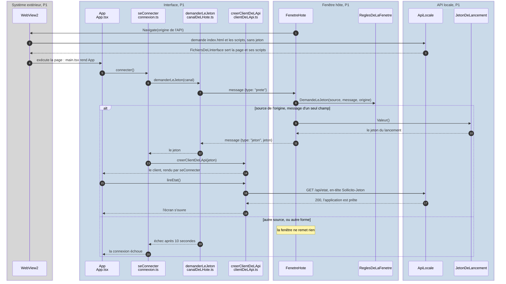
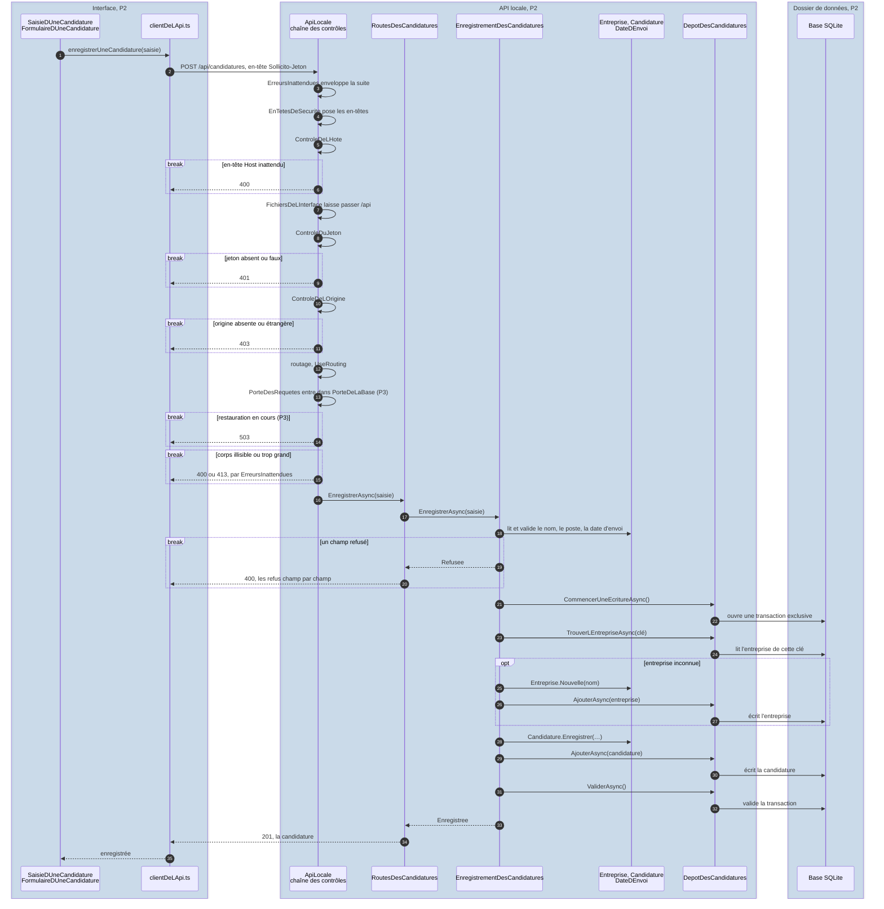
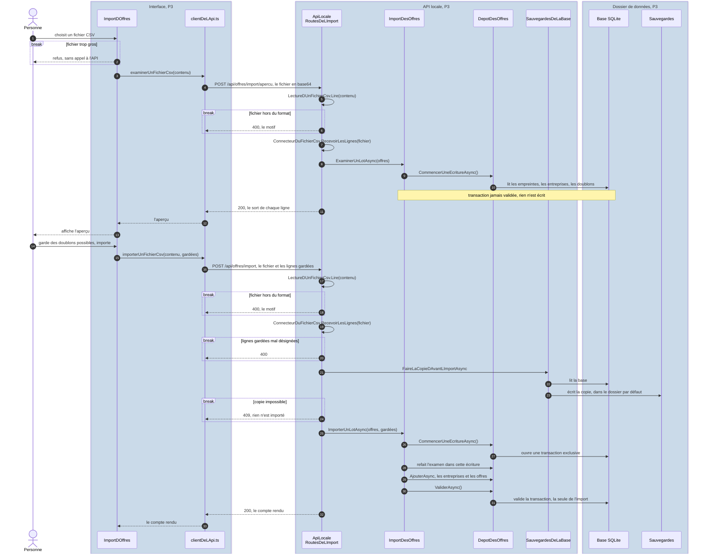
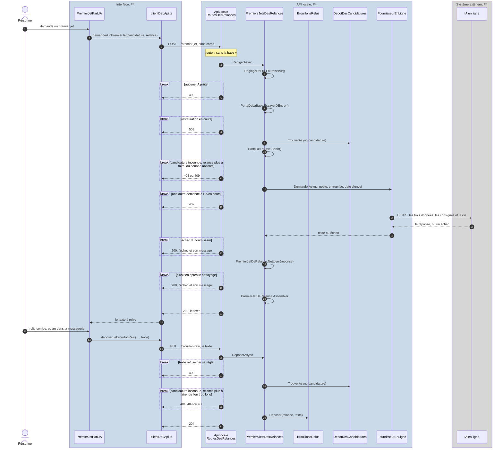
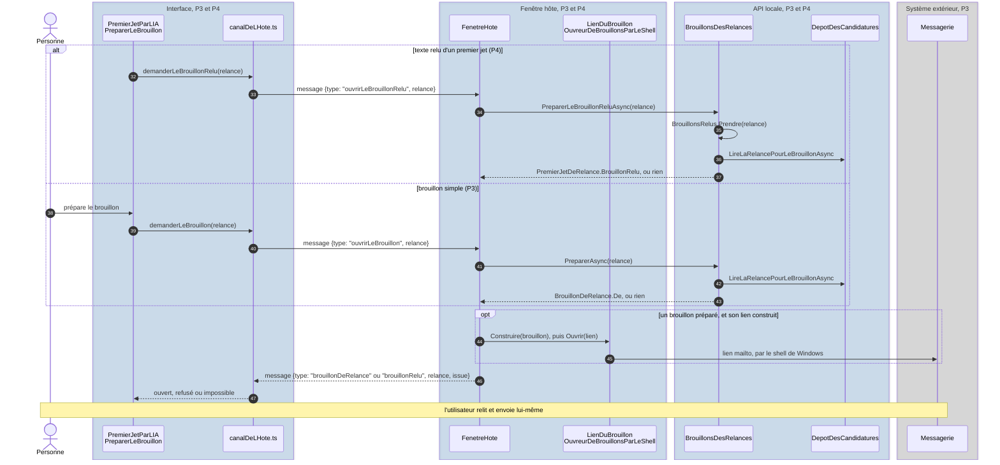

# Diagrammes de séquence de la V1

- **Mis à jour le** : 2026-11-28, avec #59
- **Décisions** : [ADR-0001](adr/0001-cadrage-architecture-v1.md), D12 (diagrammes UML dans `docs/`) ; [ADR-0003](adr/0003-hote-interface-webview2.md) (hôte de l'interface, canal du jeton) ; [ADR-0004](adr/0004-v1-resserree-paliers.md) (V1 resserrée, livrée en paliers) ; [ADR-0011](adr/0011-relances-et-brouillon.md) (brouillon d'une relance) ; [ADR-0015](adr/0015-import-csv-des-offres.md) (import d'un fichier CSV) ; [ADR-0019](adr/0019-brouillon-de-relance-redige-par-l-ia.md) (brouillon rédigé par l'IA)
- **Périmètre** : quatre parcours clés de la V1, tels que le code les fait. De quoi Sollicito est fait : [vues d'architecture](vues-d-architecture.md), et sa [vue des composants](vues-d-architecture.md#vue-des-composants)

| Parcours | Palier |
| --- | --- |
| [La remise du jeton](#la-remise-du-jeton) | P1 |
| [L'enregistrement d'une candidature](#lenregistrement-dune-candidature) | P2 |
| [L'import d'offres d'un fichier CSV](#limport-doffres-dun-fichier-csv) | P3 |
| [Le brouillon d'une relance](#le-brouillon-dune-relance) | P3, P4 |

## Lire les diagrammes

Un participant porte le nom d'une classe, d'une fonction ou d'un fichier du code, ou désigne une personne, un système extérieur ou des données. Un message nomme un appel, une route ou un message entre la page et la fenêtre, ou décrit un geste, une réponse ou un effet. Seuls les refus qui changent le parcours sont dessinés, et les classes d'aide n'y sont pas. Chaque diagramme a sa légende. Les paliers sont ceux des [vues d'architecture](vues-d-architecture.md) : P1 à P5.

## La remise du jeton

La page ne reçoit le jeton que de la fenêtre, et seulement après avoir dit qu'elle est prête (ADR-0003, « Canal du jeton » ; [modèle de menaces](modele-de-menaces.md), « Canal du jeton »).

| Légende | Sens |
| --- | --- |
| Cadre bleuté | un conteneur de Sollicito, avec le palier du parcours |
| Cadre gris | un système extérieur |
| Flèche pleine | un appel, une requête ou un message |
| Flèche pointillée | une réponse |
| Numéro | l'ordre des messages |
| Bloc `alt` | une branche parmi plusieurs |
| Encadré posé sur des lignes verticales | une précision sur ces participants |

La fenêtre fait naviguer le contrôle WebView2, dont le runtime demande la page puis l'exécute. Le jeton naît avec l'API, à chaque lancement, et la page ne le garde qu'en mémoire.

## L'enregistrement d'une candidature

De l'écran à la base : la requête passe les contrôles d'`ApiLocale` dans leur ordre, puis les couches de l'API. Les mêmes contrôles reçoivent toutes les requêtes des parcours suivants.

| Légende | Sens |
| --- | --- |
| Cadre bleuté | un conteneur de Sollicito, ou son dossier de données, avec le palier du parcours |
| Flèche pleine | un appel, une requête ou un message ; vers son départ, une étape interne |
| Flèche pointillée | une réponse |
| Numéro | l'ordre des messages |
| Bloc `opt` | une étape qui n'a lieu que sous sa condition |
| Bloc `break` | un refus ou un échec : le parcours s'arrête là |

`EnregistrementDesCandidatures` écrit par le port `IDepotDesCandidatures` et son écriture, `IEcritureDesCandidatures`, que `DepotDesCandidatures` réalise sur `BaseDeSollicito`. La porte de la base est venue avec la restauration, au palier 3.

## L'import d'offres d'un fichier CSV

En V1, les offres entrent par le collage et par l'import d'un fichier CSV (#40). L'import se fait en deux requêtes, sur deux gestes : un aperçu, qui n'écrit rien, puis l'import, précédé d'une copie de la base.

| Légende | Sens |
| --- | --- |
| Silhouette | la personne qui se sert de Sollicito |
| Cadre bleuté | un conteneur de Sollicito, ou son dossier de données, avec le palier du parcours |
| Flèche pleine | un appel, une requête ou un message ; vers son départ, une étape interne |
| Flèche pointillée | une réponse |
| Numéro | l'ordre des messages |
| Bloc `break` | un refus ou un échec : le parcours s'arrête là |
| Encadré posé sur des lignes verticales | une précision sur ces participants |

Les deux requêtes passent les contrôles du parcours précédent. `ImportDesOffres` écrit par les ports `IDepotDesOffres` et `IEcritureDesOffres` ; son format : [import CSV](import-csv.md).

L'import des offres du Forem, en tâche de fond, attend la V2 (ADR-0004, D4). La seule tâche de fond de la V1 est la sauvegarde automatique (`SauvegardesAutomatiques`, #26, [ADR-0008](adr/0008-sauvegardes-de-la-base.md)) : au lancement, la copie du jour si elle manque ; toutes les heures, celle d'un nouveau jour, ou un nouvel essai après un échec ; à la fermeture, la copie du jour refaite.

## Le brouillon d'une relance

La V1 a deux brouillons : le brouillon simple (P3) et celui dont le texte part du premier jet de l'IA (P4), relu avant l'ouverture. Les deux finissent de la même façon : la fenêtre ouvre le brouillon dans la messagerie, et l'utilisateur l'envoie lui-même. Il se lit en deux diagrammes, coupés à la réponse au dépôt du texte relu.

### Le premier jet de l'IA et son dépôt

| Légende | Sens |
| --- | --- |
| Silhouette | la personne qui se sert de Sollicito |
| Cadre bleuté | un conteneur de Sollicito, avec le palier du parcours |
| Cadre gris | un système extérieur |
| Flèche pleine | un appel, une requête ou un message ; vers son départ, une étape interne |
| Flèche pointillée | une réponse |
| Numéro | l'ordre des messages |
| Bloc `break` | un refus ou un échec : le parcours s'arrête là |
| Encadré posé sur des lignes verticales | une précision sur ces participants |

Avant de montrer le bouton du premier jet, l'écran lit l'état de l'IA (`GET /api/reglages/ia`). La porte de la base encadre la lecture de la relance ; le dépôt du texte relu, lui, la traverse par `PorteDesRequetes`. L'adaptateur lit la clé et prend `PorteDesDemandes`, qui ne laisse passer qu'une demande à la fois. `FournisseurEnLigne` est la base de `ClaudeEnLigne` et d'`OpenAIEnLigne`, derrière le port `IFournisseurDIA`.

### L'ouverture du brouillon dans la messagerie

| Légende | Sens |
| --- | --- |
| Silhouette | la personne qui se sert de Sollicito |
| Cadre bleuté | un conteneur de Sollicito, avec le palier du parcours |
| Cadre gris | un système extérieur |
| Flèche pleine | un appel, une requête ou un message ; vers son départ, une étape interne |
| Flèche pointillée | une réponse |
| Numéro | l'ordre des messages, à la suite du diagramme précédent |
| Bloc `alt` | une branche parmi plusieurs |
| Bloc `opt` | une étape qui n'a lieu que sous sa condition |
| Encadré posé sur des lignes verticales | une précision sur ces participants |

Avant d'ouvrir, la fenêtre vérifie la source et la forme de chaque message (`ReglesDeLaFenetre`), comme pour le jeton ; sans réponse en 15 secondes, la page cesse d'attendre. Les deux messages qui demandent un brouillon ne portent que l'identifiant de la relance, jamais le texte ni l'adresse. `BrouillonsDesRelances` prend le texte relu dans `BrouillonsRelus`, et la porte de la base encadre sa préparation. `OuvreurDeBrouillonsParLeShell` implémente `IOuvreurDeBrouillons`.

Ce que reçoit la messagerie, et quand cela quitte le poste : [vues d'architecture](vues-d-architecture.md#ce-qui-quitte-le-poste), échange ③ ; ce que reçoit l'IA en ligne : échange ①.
