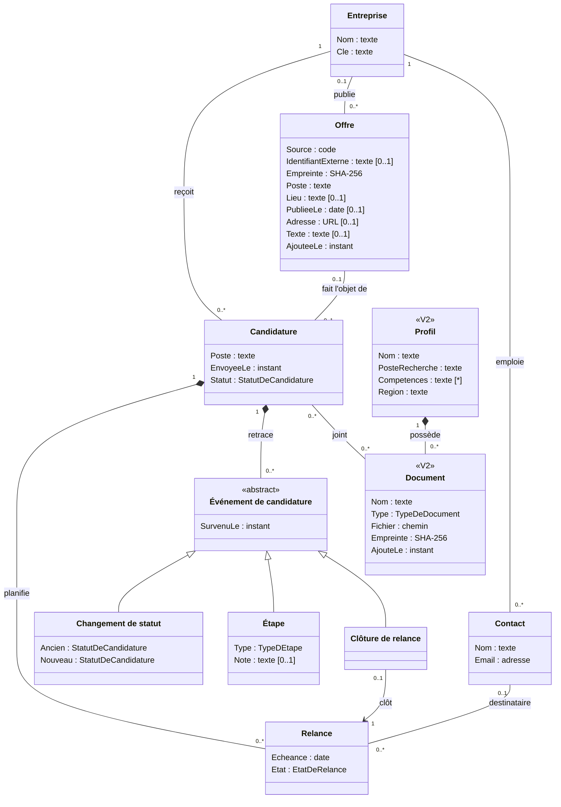
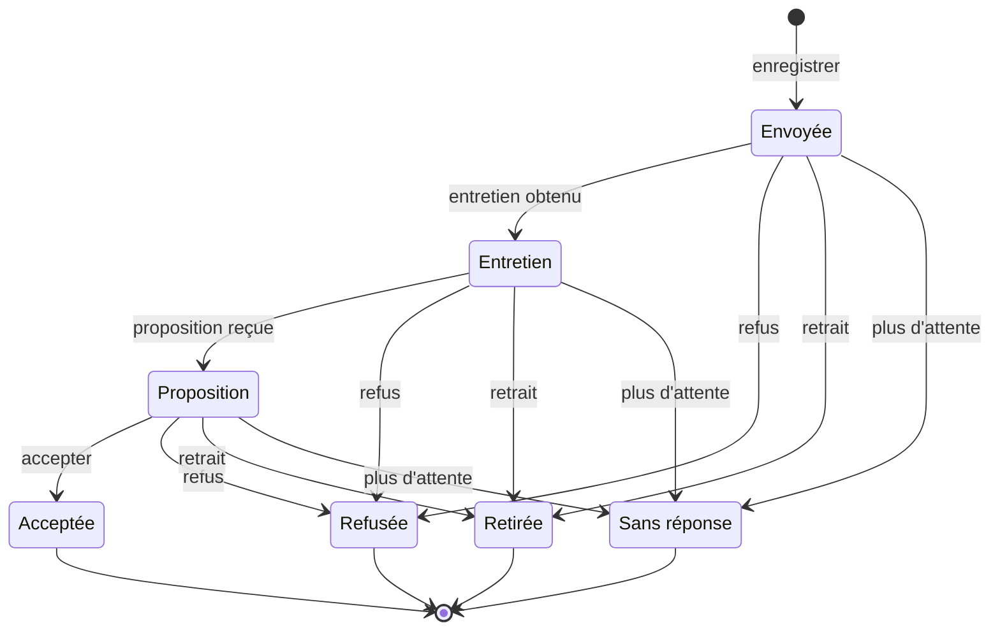
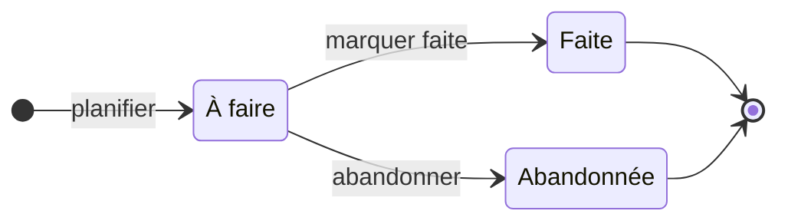

# Modèle de domaine de la V1

- **Mis à jour le** : 2026-11-18, avec #6
- **Décisions** : [ADR-0001](adr/0001-cadrage-architecture-v1.md), D5 ; [ADR-0005](adr/0005-modele-de-domaine.md) (entreprises reconnues, offres dédoublonnées, dates et heures)
- **Périmètre** : les huit entités de la D5. Six entrent en base en V1 : Entreprise, Contact, Offre, Candidature, Événement de candidature et Relance. Profil et Document sont modélisés ici et entrent en base en V2 ([spec de la V1](https://github.com/moonn1000/sollicito/issues/5), « Entités en base »).

Ce modèle remplace l'esquisse de la D5 (ADR-0005). Le code du domaine le suit à partir de #11 : une pull request qui s'en écarte met ce document à jour.

## Les entités

| Entité | Ce qu'elle représente | En base |
| --- | --- | --- |
| Entreprise | une organisation à qui l'on postule, ou qui publie une offre | V1 |
| Contact | une personne d'une entreprise, à qui adresser une relance | V1 |
| Offre | une offre d'emploi importée : un texte collé, ou une ligne d'un fichier CSV | V1 |
| Candidature | une candidature envoyée à une entreprise, pour un poste | V1 |
| Événement de candidature | une étape datée de l'historique d'une candidature | V1 |
| Relance | une relance prévue d'une candidature | V1 |
| Profil | la personne qui cherche un emploi : poste recherché, compétences | V2 |
| Document | un CV ou une lettre, copié dans le dossier de données | V2 |

## Diagramme de classes

Pour lire le diagramme :

- Chaque entité a aussi un identifiant technique, que le diagramme ne montre pas.
- `[0..1]` marque un attribut facultatif, `[*]` une liste. «V2» marque une entité modélisée, qui n'entre en base qu'en V2.
- Types : `texte` ; `code`, un texte court fixé par le programme ; `instant`, une date et une heure gardées en UTC ; `date`, un jour du calendrier, sans heure ni fuseau (voir « Dates et heures ») ; `SHA-256`, une empreinte en hexadécimal ; `adresse`, une adresse électronique ; `URL`, une adresse web en `http` ou `https` (ADR-0001, D9).
- Le losange plein marque une composition : les événements et les relances d'une candidature n'existent que par elle, et la supprimer les supprime (#25).

### Les liens

| Lien | Multiplicités | Ce qu'il dit |
| --- | --- | --- |
| Entreprise – Candidature | 1 – 0..* | une candidature a toujours son entreprise, offre ou pas |
| Entreprise – Offre | 0..1 – 0..* | une offre peut taire son entreprise : offre anonyme, ligne de CSV sans entreprise |
| Entreprise – Contact | 1 – 0..* | un contact appartient à une seule entreprise |
| Offre – Candidature | 0..1 – 0..1 | une offre fait l'objet d'au plus une candidature ; une candidature peut se passer d'offre (#11) |
| Candidature – Événement de candidature | 1 – 0..* | l'historique de la candidature |
| Candidature – Relance | 1 – 0..* | ses relances, dont une seule à faire à la fois |
| Contact – Relance | 0..1 – 0..* | le destinataire : un contact de l'entreprise de la candidature, ou personne |
| Clôture de relance – Relance | 0..1 – 1 | une relance faite ou abandonnée entre dans l'historique |
| Candidature – Document | 0..* – 0..* | V2 : un même document sert à plusieurs candidatures (#42) |
| Profil – Document | 1 – 0..* | V2 : les documents de la personne |

La candidature est la racine de son agrégat : ses événements et ses relances ne s'ajoutent et ne changent que par elle, qui tient ainsi ses règles (passages de statut, une seule relance à faire). L'entreprise, le contact et l'offre vivent à part ; la candidature les désigne par leur identifiant.

### Événement de candidature : une entité, trois sortes

| Sorte | Ce qu'elle garde | Datée par |
| --- | --- | --- |
| Changement de statut | l'ancien et le nouveau statut | l'horloge, au moment du passage |
| Étape | un type et une note facultative ; elle ne change pas le statut (#41, absorbée par #12) | l'utilisateur, passée ou à venir |
| Clôture de relance | la relance faite ou abandonnée | l'horloge, au moment où on la marque |

- Les trois sortes vivent dans une seule table, avec une colonne qui dit la sorte : c'est l'héritage par défaut d'EF Core, une table par hiérarchie[^ef-heritage]. La V1 garde ainsi six entités en base.
- L'envoi n'est pas un événement : la candidature le date elle-même (`EnvoyeeLe`), et son historique commence là.
- L'historique se lit par `SurvenuLe`, du plus ancien au plus récent ; à égalité, dans l'ordre d'enregistrement.
- Une étape « Entretien » note un entretien ; le statut Entretien dit qu'on en a obtenu un. Noter une étape ne fait pas avancer la candidature.

### Types énumérés

| Type | Valeurs |
| --- | --- |
| `StatutDeCandidature` | `Envoyee`, `Entretien`, `Proposition`, `Acceptee`, `Refusee`, `Retiree`, `SansReponse` (voir « Statuts d'une candidature ») |
| `EtatDeRelance` | `AFaire`, `Faite`, `Abandonnee` |
| `TypeDEtape` | `Appel`, `Entretien`, `Echange` (courriel, message), `Autre` |
| `TypeDeDocument` (V2) | `Cv`, `Lettre`, `Autre` |

## Statuts d'une candidature

| Statut | Ce qu'il dit | Passages permis |
| --- | --- | --- |
| Envoyée | la candidature est partie ; on attend une réponse | Entretien, Refusée, Retirée, Sans réponse |
| Entretien | l'entreprise a proposé au moins un entretien | Proposition, Refusée, Retirée, Sans réponse |
| Proposition | l'entreprise propose un contrat | Acceptée, Refusée, Retirée, Sans réponse |
| Acceptée | vous avez accepté la proposition | aucun |
| Refusée | l'entreprise a dit non, ou a retiré sa proposition | aucun |
| Retirée | vous avez arrêté : retrait, ou proposition déclinée | aucun |
| Sans réponse | vous n'attendez plus de réponse | aucun |

Cette table fait foi, et le diagramme la dessine. L'API refuse tout autre passage avec un message lisible, y compris vers le statut déjà en place (#12).

- **Départ** : une candidature commence toujours à Envoyée, avec sa date et son heure d'envoi, qui ne peuvent pas être dans le futur. Ce qui n'est pas encore envoyé reste une offre (#38).
- **En cours ou close** : Envoyée, Entretien et Proposition sont en cours ; les quatre autres statuts closent la candidature.
- **Chaque passage** ajoute un changement de statut à l'historique, daté par l'horloge.
- **Annuler le dernier changement** : c'est la seule autre façon de changer de statut. L'annulation retire de l'historique le dernier changement de statut et rend à la candidature le statut d'avant ; répétée, elle remonte jusqu'à Envoyée. Elle corrige une erreur de clic, et reprend une candidature close, par exemple quand une réponse arrive après « Sans réponse ». Ce n'est pas un passage : le diagramme ne la montre pas. Une relance abandonnée à la clôture reste abandonnée.
- **Le statut n'est pas un champ** : modifier une candidature (#25) ne le touche pas.
- **Règle de cohérence** : le statut d'une candidature est le nouveau statut de son dernier changement, ou Envoyée si elle n'en a aucun.

## Relances

- **Planifier** : sur une candidature en cours seulement, et une relance à faire au plus par candidature.
- **Échéance** : la date locale de l'envoi, plus un délai en jours (voir « Dates et heures »). Le délai par défaut est un réglage de l'application, hors des entités du domaine : #14 fixe sa valeur et le range avec les autres réglages. On peut le changer pour une relance. L'échéance est enregistrée telle quelle : corriger ensuite la date d'envoi (#25) ne la déplace pas.
- **Échue** : une relance à faire dont l'échéance tombe aujourd'hui ou avant, en date locale.
- **Destinataire** : l'utilisateur le choisit parmi les contacts de l'entreprise de la candidature. Si l'entreprise n'en a qu'un, il est proposé d'office ; si elle n'en a aucun, la relance reste sans destinataire, et son brouillon s'ouvre sans (#14). Rattacher la candidature à une autre entreprise (#25) retire le destinataire de sa relance à faire.
- **Faite ou abandonnée** : c'est définitif, et une clôture de relance entre dans l'historique de la candidature.
- **Clore la candidature** abandonne sa relance à faire.

## Contact

Le contact de la V1 est minimal :

| Attribut | Règle |
| --- | --- |
| `Nom` | requis |
| `Email` | requis : une seule adresse, de la forme `nom@domaine`, de 254 caractères au plus, sans liste ni séparateur (`,`, `;`), sans paramètre (`?`), sans espace ni caractère de contrôle. Le lien `mailto` que construit l'hôte de la fenêtre ne peut ainsi viser qu'elle (ADR-0003) ; #14 détaille la validation. |
| `Entreprise` | requise |

La fonction et le téléphone du contact (#30) attendent la V2.

## Reconnaître une entreprise

Une entreprise se reconnaît à sa clé, tirée de son nom. Deux noms qui donnent la même clé désignent la même entreprise : la saisie d'une candidature (#11) ou d'une offre reprend alors l'entreprise enregistrée, sans en créer une seconde.

La clé se calcule dans cet ordre :

1. décomposer les caractères (Unicode NFKD) et retirer les accents : « Société » devient « Societe » ;
2. passer en minuscules, sans dépendre de la langue du poste (culture invariante) ;
3. retirer les points, et remplacer par une espace tout autre caractère qui n'est ni une lettre ni un chiffre : « S.A. » devient « sa », « L’Oréal » devient « l oreal » ;
4. réduire les suites d'espaces à une seule, et retirer celles du début et de la fin ;
5. retirer la forme juridique qui termine le nom, tant qu'il y en a une : `sa`, `nv`, `srl`, `bv`, `sprl`, `bvba`, `sc`, `cv`, `scrl`, `cvba`, `snc`, `vof`, `scomm`, `commv`, `scs`, `gcv`, `sca`, `cva`, `asbl`, `vzw`, `aisbl`, `ivzw`, `se`, `sas`, `sarl`, `gmbh`, `ag`, `ltd`, `inc`, `llc`, `plc` ;
6. retirer de même la forme qui ouvre le nom, mais seulement parmi les formes belges qui ne commencent jamais une marque : `asbl`, `vzw`, `aisbl`, `ivzw`, `srl`, `sprl`, `bvba`, `scrl`, `cvba`.

Les étapes 5 et 6 ne retirent jamais le dernier mot : « SA » seul garde la clé `sa`. Un nom sans lettre ni chiffre (« !!! ») est refusé à la saisie.

| Nom saisi | Clé |
| --- | --- |
| Proximus SA | `proximus` |
| PROXIMUS S.A. | `proximus` |
| Proximus NV/SA | `proximus` |
| Société Générale | `societe generale` |
| L’Oréal Belgilux | `l oreal belgilux` |
| Brasserie Dupont S.R.L. | `brasserie dupont` |
| SRL Dupont | `dupont` |
| ASBL Les Amis | `les amis` |
| AG Insurance SA | `ag insurance` |
| SC Johnson | `sc johnson` |
| NV Bekaert SA | `nv bekaert` |
| Delhaize Le Lion | `delhaize le lion` |

- « AG Insurance » et « SC Johnson » gardent leur début, où AG et SC ne sont pas des formes juridiques. Les formes courtes ne se retirent donc qu'en fin de nom, au prix de « NV Bekaert SA », qui ne rejoint pas « Bekaert ».
- La clé ne rapproche pas deux noms différents : « Delhaize Le Lion » et « Delhaize » font deux entreprises. L'écran de saisie propose donc les entreprises déjà enregistrées pendant qu'on tape (#11).
- Le nom affiché est celui de la première saisie.
- Changer l'entreprise d'une candidature (#25) la rattache à l'entreprise que reconnaît le nouveau nom, ou en crée une. L'ancienne entreprise n'est pas renommée.

## Dédoublonner les offres

Une offre arrive par un connecteur (ADR-0001, D6) : en V1, le texte collé (#36) ou le fichier CSV (#40). Trois règles disent si elle est déjà enregistrée.

1. **Même source, identifiant connu** : le couple (source, identifiant externe) est unique (D5). Une offre reconnue n'est ni recréée ni écrasée. En V1, aucune source ne fournit d'identifiant sûr : le texte collé n'en a pas, et l'identifiant d'un fichier CSV tenu ailleurs ne vaut que dans ce fichier. La règle servira au Forem, en V2.
2. **Même source, même texte** : sans identifiant externe, le couple (source, empreinte) est unique. L'empreinte est le SHA-256 du texte normalisé : décomposition et recomposition Unicode (NFKC), minuscules, tout blanc (espace, tabulation, saut de ligne, espace insécable) réduit à une espace, sans blanc au début ni à la fin. Pour une offre collée, c'est le texte collé ; pour une ligne de CSV, ses champs mis bout à bout, dans l'ordre du format de #40. Recoller le même texte retrouve l'offre enregistrée, même si ses espaces ou ses sauts de ligne ont changé.
3. **D'une source à l'autre, ou d'un texte à l'autre** : jamais de fusion automatique. Quand une nouvelle offre a la même entreprise (même clé) et le même poste normalisé qu'une offre déjà enregistrée, quelle que soit la source, l'application signale un doublon possible, avec un lien vers l'autre offre. L'utilisateur garde les deux, ou renonce à la nouvelle. Le poste se normalise comme le nom d'une entreprise, sans retirer de forme juridique : « Développeur .NET (H/F) » et « developpeur  .net h/f » donnent tous deux `developpeur net h f`. Une offre sans entreprise n'est pas comparée.

- À l'import d'un fichier CSV (#40), une ligne reconnue par la règle 1 ou 2 est écartée et signalée dans le compte rendu ; un doublon possible (règle 3) est importé, et signalé comme tel.
- Le texte d'une offre ne change plus après l'import (#36 le garde tel quel) : son empreinte reste juste.
- **Postuler** (#38) : la candidature reprend l'entreprise et le poste de l'offre, puis vit sa vie ; modifier l'offre ensuite ne la change pas. Une offre sans entreprise en demande une avant. Une offre qui a déjà sa candidature n'en reçoit pas une seconde, et le signal de la règle 3 vaut aussi à ce moment : un doublon possible déjà postulé est montré. Supprimer la candidature (#25) laisse l'offre, qui peut en recevoir une nouvelle.

## Dates et heures

Deux sortes de valeurs, jamais mêlées :

| Sorte | Attributs | Gardée en | Exemple |
| --- | --- | --- | --- |
| Instant : un moment précis | `EnvoyeeLe`, `SurvenuLe`, `AjouteeLe`, `AjouteLe` (V2) | UTC, `DateTime` de genre `Utc` | `2026-03-27T22:30:00Z` |
| Date : un jour du calendrier | `Echeance`, `PublieeLe` | `DateOnly`, sans heure ni fuseau | `2026-04-03` |

- **Le fuseau est celui de Windows**, sur le poste de l'utilisateur. En Belgique, c'est « Romance Standard Time », l'équivalent Windows d'`Europe/Brussels` : UTC+1 en hiver, UTC+2 en été. Le code le lit par `TimeProvider` (`GetUtcNow`, `LocalTimeZone`), que les tests remplacent pour fixer l'heure et le fuseau.
- **Saisie** : l'interface envoie la date et l'heure telles que l'utilisateur les a tapées, sans décalage (`2026-03-27T23:30`). L'API les convertit en UTC dans le fuseau du poste : les deux règles qui suivent vivent ainsi en un seul endroit, testé en .NET. Le navigateur ne les suit pas : il avance sans prévenir une heure qui n'existe pas, et lit à l'heure d'été une heure qui existe deux fois. L'API rend toujours des instants en UTC, que l'interface affiche dans le fuseau du poste.
- **Heure qui n'existe pas** : au passage à l'heure d'été, l'horloge saute de 02:00 à 03:00, le 29/03/2026 puis le 28/03/2027. Une heure de ce trou, comme 02:30, est refusée avec un message ; .NET la dit invalide[^dotnet-fuseaux].
- **Heure qui existe deux fois** : au retour à l'heure d'hiver, l'horloge revient de 03:00 à 02:00, le 25/10/2026 puis le 31/10/2027. Une heure de cette plage se lit à l'heure d'hiver (UTC+1), comme le fait `TimeZoneInfo.ConvertTimeToUtc` : 02:30 le 25/10/2026 donne `2026-10-25T01:30:00Z`[^dotnet-ambigu].
- **Calculs en jours**, dont l'échéance d'une relance : sur la date, jamais en heures. On prend la date locale de l'instant, puis on ajoute des jours.
- **Aujourd'hui** : la date locale de l'horloge.
- **Stockage** (#11) : EF Core écrit ces valeurs en texte dans SQLite. Il traduit en SQL les comparaisons et les tris de `DateTime` et de `DateOnly`, mais pas ceux de `DateTimeOffset`, qu'il fait en mémoire[^ef-sqlite][^ef-fonctions] : d'où le `DateTime` en UTC. À la lecture, un convertisseur rend au `DateTime` son genre `Utc`[^ef-genre].

### Exemple

Une candidature envoyée le vendredi 27 mars 2026 à 23:30, heure de Bruxelles, avec une relance à 7 jours :

| Étape | Valeur |
| --- | --- |
| Heure saisie | `2026-03-27T23:30`, à l'heure d'hiver (UTC+1) |
| `EnvoyeeLe` enregistré | `2026-03-27T22:30:00Z` |
| Date locale de l'envoi | 27/03/2026 |
| `Echeance` : 27/03 + 7 jours | vendredi 3 avril 2026, enregistrée `2026-04-03` |
| Envoi affiché en avril, à l'heure d'été | toujours 27/03/2026 à 23:30 : la conversion prend le décalage en vigueur à l'instant de l'envoi |

Le passage à l'heure d'été tombe entre les deux, le 29 mars. Un calcul en heures, 22:30 UTC + 7 × 24 h, donnerait le 3 avril à 22:30 UTC, soit le samedi 4 avril à 00:30 à Bruxelles (UTC+2) : un jour trop tard.

Deux conversions de plus, pour les tests : le 18/11/2026 à 14:30 donne `2026-11-18T13:30:00Z`, et le 01/07/2026 à 14:30 donne `2026-07-01T12:30:00Z`.

Ces valeurs ont été relevées le 2026-11-18 par une sonde en .NET 10 (`TimeZoneInfo`, fuseau « Romance Standard Time » de Windows 11), et la lecture du navigateur dans Chromium.

## Ce que les stories en reprennent

| Story | Ce qu'elle reprend du modèle |
| --- | --- |
| #11 | l'entreprise et sa clé ; la candidature : poste, date d'envoi jamais future, départ à Envoyée ; les instants en UTC et leur convertisseur ; la conversion des heures saisies |
| #12 | les passages permis, l'annulation du dernier changement, les trois sortes d'événement et l'ordre de l'historique |
| #14 | le contact minimal ; les règles des relances : candidature en cours, une seule à faire, échéance sur la date, délai par défaut en réglage, choix du destinataire, clôture dans l'historique, abandon quand la candidature se clôt |
| #25 | les champs modifiables : poste, entreprise (reconnue de nouveau) et date d'envoi, mais pas le statut ; la suppression d'une candidature emporte ses événements et ses relances, et laisse son offre et son entreprise |
| #36 | la règle 2, sur le texte collé ; la règle 3 ; le texte gardé tel quel |
| #38 | une offre, au plus une candidature ; « Postuler » reprend l'entreprise et le poste ; l'offre sans entreprise |
| #40 | les règles 2 et 3 pour une ligne de CSV, et leur compte rendu |

## En V2

- **Profil** et **Document** entrent en base, avec le module Profil (ADR-0001, D4) et les documents joints (#42).
- **Forem** : cette source fournira des identifiants (règle 1). Ses offres côtoieront des offres collées ; l'ADR-0005 garde ce point à vérifier.

## Sources

Consultées le 2026-11-18 :

[^ef-heritage]: Microsoft Learn, EF Core, héritage (une table par hiérarchie, par défaut) : <https://learn.microsoft.com/en-us/ef/core/modeling/inheritance>
[^ef-sqlite]: Microsoft Learn, EF Core, limites du fournisseur SQLite (`DateTimeOffset` comparé et trié en mémoire) : <https://learn.microsoft.com/en-us/ef/core/providers/sqlite/limitations>
[^ef-fonctions]: Microsoft Learn, EF Core, fonctions traduites par le fournisseur SQLite (`DateTime`, `DateOnly`) : <https://learn.microsoft.com/en-us/ef/core/providers/sqlite/functions>
[^ef-genre]: Microsoft Learn, EF Core, conversions de valeurs (« Specify the DateTime.Kind when reading dates ») : <https://learn.microsoft.com/en-us/ef/core/modeling/value-conversions>
[^dotnet-fuseaux]: Microsoft Learn, .NET, vue d'ensemble des fuseaux horaires (heures invalides et ambiguës) : <https://learn.microsoft.com/en-us/dotnet/standard/datetime/time-zone-overview>
[^dotnet-ambigu]: Microsoft Learn, .NET, résoudre une heure ambiguë (la lire à l'heure d'hiver) : <https://learn.microsoft.com/en-us/dotnet/standard/datetime/resolve-ambiguous-times>
