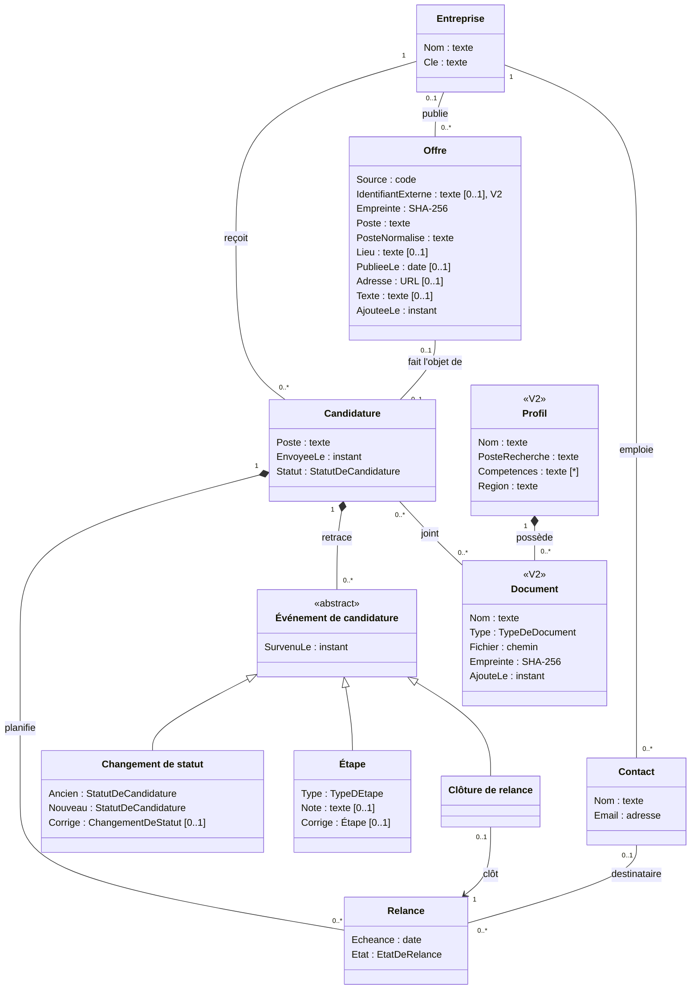
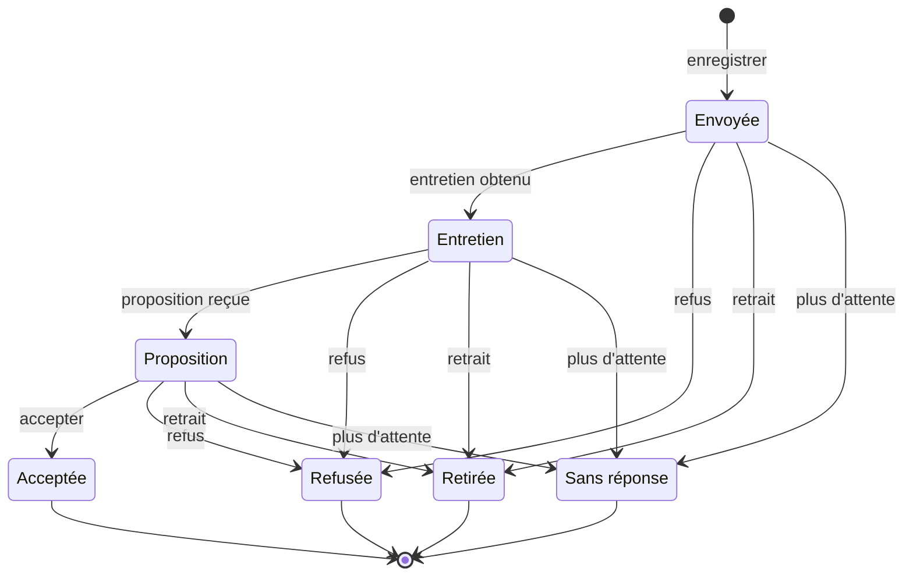
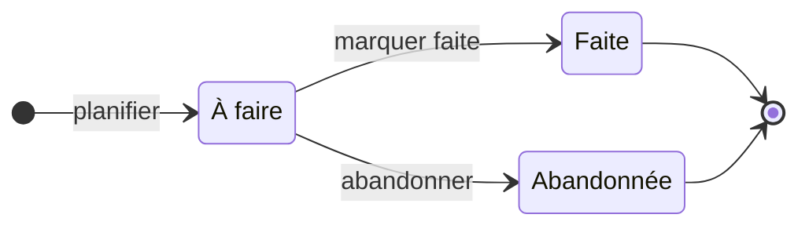

# Modèle de domaine de la V1

- **Mis à jour le** : 2026-11-24, avec #36 (coller une offre), puis avec #38 (postuler à une offre), puis avec #40 (importer des offres d'un fichier CSV)
- **Décisions** : [ADR-0001](adr/0001-cadrage-architecture-v1.md), D5 ; [ADR-0005](adr/0005-modele-de-domaine.md) (entreprises reconnues, offres dédoublonnées, dates et heures) ; [ADR-0007](adr/0007-historique-en-vigueur-et-nom-corrige.md) (étapes corrigées et historique en vigueur, nom affiché corrigé, entreprises proposées) ; [ADR-0008](adr/0008-sauvegardes-de-la-base.md) (réglages de l'application, hors de la base) ; [ADR-0011](adr/0011-relances-et-brouillon.md) (contact minimal, relances, brouillon et délai par défaut) ; [ADR-0013](adr/0013-offres-collees.md) (offres collées, empreinte, doublon possible avec accord, entreprises proposées) ; [ADR-0014](adr/0014-postuler-a-une-offre.md) (postuler à une offre, le lien porté par la candidature, la liste filtrée dans la page) ; [ADR-0015](adr/0015-import-csv-des-offres.md) (import d'un fichier CSV : le sort d'une ligne, l'empreinte sur les champs lus, le doublon possible gardé ligne à ligne)
- **Périmètre** : les huit entités de la D5. Six entrent en base en V1 : Entreprise, Contact, Offre, Candidature, Événement de candidature et Relance. Profil et Document sont modélisés ici et entrent en base en V2 ([spec de la V1](https://github.com/moonn1000/sollicito/issues/5), « Entités en base »).

Ce modèle remplace l'esquisse de la D5 (ADR-0005). Le code du domaine le suit depuis #11 (`src/Sollicito.Domain`) : une pull request qui s'en écarte met ce document à jour. #11 y a ajouté les règles de la saisie (voir « Saisie d'une candidature ») ; #12, celles d'une étape (voir « Noter une étape ») ; #25, celles de la modification et de la suppression (voir « Modifier ou supprimer une candidature ») ; #14, celles des relances et du contact (voir « Relances » et « Contact ») ; #36, celles d'une offre collée et de sa correction (voir « Coller une offre ») ; #38, celles de « Postuler » et de la liste des offres (voir « Postuler à une offre ») ; #40, celles d'une ligne d'un fichier CSV (voir « Dédoublonner les offres »).

## Les entités

| Entité | Ce qu'elle représente | En base |
| --- | --- | --- |
| Entreprise | une organisation à qui l'on postule, ou qui publie une offre | V1 |
| Contact | une personne d'une entreprise, à qui adresser une relance | V1 |
| Offre | une offre d'emploi importée : un texte collé, ou une ligne d'un fichier CSV | V1 |
| Candidature | une candidature envoyée à une entreprise, pour un poste | V1 |
| Événement de candidature | une étape datée de l'historique d'une candidature | V1 |
| Relance | une relance prévue d'une candidature | V1 |
| Profil | la personne qui cherche un emploi : poste recherché, compétences | V2 |
| Document | un CV ou une lettre, copié dans le dossier de données | V2 |

## Diagramme de classes

Pour lire le diagramme :

- Chaque entité a aussi un identifiant technique, que le diagramme ne montre pas.
- `[0..1]` marque un attribut facultatif, `[*]` une liste. «V2» marque une entité modélisée, qui n'entre en base qu'en V2 ; « V2 », après un attribut, un attribut qui n'y entre qu'en V2 : l'identifiant externe d'une offre attend une source qui en fournit un, le Forem (ADR-0013).
- Types : `texte` ; `code`, un texte court fixé par le programme ; `instant`, une date et une heure gardées en UTC ; `date`, un jour du calendrier, sans heure ni fuseau (voir « Dates et heures ») ; `SHA-256`, une empreinte en hexadécimal ; `adresse`, une adresse électronique ; `URL`, une adresse web en `http` ou `https` (ADR-0001, D9).
- Le losange plein marque une composition : les événements et les relances d'une candidature n'existent que par elle, et supprimer la candidature les supprime aussi (#25). En V2, les documents appartiennent de même au profil.

### Les liens

| Lien | Multiplicités | Ce qu'il dit |
| --- | --- | --- |
| Entreprise – Candidature | 1 – 0..* | une candidature a toujours son entreprise, offre ou pas |
| Entreprise – Offre | 0..1 – 0..* | une offre peut taire son entreprise : offre anonyme, ligne de CSV sans entreprise |
| Entreprise – Contact | 1 – 0..* | un contact appartient à une seule entreprise |
| Offre – Candidature | 0..1 – 0..1 | une offre fait l'objet d'au plus une candidature ; une candidature peut se passer d'offre (#11). En base, la candidature porte l'identifiant de son offre, unique (#38, ADR-0014) |
| Candidature – Événement de candidature | 1 – 0..* | l'historique de la candidature |
| Candidature – Relance | 1 – 0..* | ses relances, dont une seule à faire à la fois |
| Contact – Relance | 0..1 – 0..* | le destinataire : à la planification, un contact de l'entreprise de la candidature, ou personne |
| Clôture de relance – Relance | 0..1 – 1 | une relance faite ou abandonnée entre dans l'historique |
| Changement de statut – Changement de statut (`Corrige`) | 0..1 – 0..1 | une correction désigne le changement qu'elle corrige ; un changement n'est corrigé qu'une fois |
| Étape – Étape (`Corrige`) | 0..1 – 0..1 | une correction d'étape désigne l'étape qu'elle corrige ; une étape n'est corrigée qu'une fois (#25) |
| Candidature – Document | 0..* – 0..* | V2 : un même document sert à plusieurs candidatures (#42) |
| Profil – Document | 1 – 0..* | V2 : les documents de la personne |

La candidature est la racine de son agrégat : ses événements et ses relances ne s'ajoutent et ne changent que par elle, qui tient ainsi ses règles (passages de statut, une seule relance à faire). L'entreprise, le contact et l'offre vivent à part ; la candidature les désigne par leur identifiant.

### Événement de candidature : une entité, trois sortes

| Sorte | Ce qu'elle garde | Datée par |
| --- | --- | --- |
| Changement de statut | l'ancien et le nouveau statut ; pour une correction, le changement qu'elle corrige (`Corrige`) | l'horloge, au moment du passage ou de la correction |
| Étape | un type et une note facultative ; pour une correction, l'étape qu'elle corrige (`Corrige`, #25) ; elle ne change pas le statut (#41, absorbée par #12) | l'utilisateur, passée ou à venir |
| Clôture de relance | la relance faite ou abandonnée | l'horloge, au moment où on la marque |

- Les trois sortes vivent dans une seule table, avec une colonne qui dit la sorte : c'est l'héritage par défaut d'EF Core, une table par hiérarchie[^ef-heritage]. La V1 garde ainsi six entités en base. #12 crée la table avec les deux premières sortes ; la clôture de relance l'a rejointe avec les relances (#14). Elle ne se corrige pas : elle reste toujours en vigueur.
- L'envoi n'est pas un événement : la candidature le date elle-même (`EnvoyeeLe`), et son historique en vigueur commence là. Aucun événement en vigueur ne précède l'envoi, sauf si l'horloge a reculé (limite connue, plus bas) : une étape, ou sa correction, n'est pas datée avant lui (#12, #25), et une date d'envoi corrigée ne passe pas après le premier événement en vigueur (#25).
- **En vigueur** : un événement qu'aucune correction ne désigne. Un changement corrigé, ou une étape corrigée, reste dans l'historique, marqué comme corrigé, mais n'est plus en vigueur.
- **L'envoi dans l'historique** : la fiche range l'envoi à son instant, au premier rang à égalité. Seuls des événements corrigés peuvent donc le précéder, quand une date d'envoi corrigée est passée après eux (#25) ; si l'horloge a reculé, un événement en vigueur le précède aussi (limite connue, plus bas).
- L'historique se lit par `SurvenuLe`, du plus ancien au plus récent ; à égalité, dans l'ordre d'enregistrement.
- **Une horloge qui recule** (limite connue, rare) : si l'horloge de Windows recule, un passage de statut, la clôture d'une relance ou la correction d'un changement de statut, que l'horloge date, peuvent être datés avant le dernier changement, voire avant l'envoi. L'historique, trié par instant, les montre dans cet ordre, et la correction vise toujours le dernier changement enregistré (#82, point 5 ; #85, point 2).
- Une étape « Entretien » note un entretien ; le statut Entretien dit qu'on en a obtenu un. Noter une étape ne fait pas avancer la candidature.

### Types énumérés

| Type | Valeurs |
| --- | --- |
| `StatutDeCandidature` | `Envoyee`, `Entretien`, `Proposition`, `Acceptee`, `Refusee`, `Retiree`, `SansReponse` (voir « Statuts d'une candidature ») |
| `EtatDeRelance` | `AFaire`, `Faite`, `Abandonnee` |
| `TypeDEtape` | `Appel`, `Entretien`, `Echange` (courriel, message), `Autre` |
| `TypeDeDocument` (V2) | `Cv`, `Lettre`, `Autre` |

## Statuts d'une candidature

| Statut | Ce qu'il dit | Passages permis |
| --- | --- | --- |
| Envoyée | la candidature est partie ; on attend une réponse | Entretien, Refusée, Retirée, Sans réponse |
| Entretien | l'entreprise a proposé au moins un entretien | Proposition, Refusée, Retirée, Sans réponse |
| Proposition | l'entreprise propose un contrat | Acceptée, Refusée, Retirée, Sans réponse |
| Acceptée | vous avez accepté la proposition | aucun |
| Refusée | l'entreprise a dit non, ou a retiré sa proposition | aucun |
| Retirée | vous avez arrêté : retrait, ou proposition déclinée | aucun |
| Sans réponse | vous n'attendez plus de réponse | aucun |

Cette table fait foi, et le diagramme la dessine. L'API refuse tout autre passage avec un message lisible, y compris vers le statut déjà en place (#12).

- **Départ** : une candidature commence toujours à Envoyée, avec sa date et son heure d'envoi, qui ne peuvent pas être dans le futur. Ce qui n'est pas encore envoyé reste une offre (#38).
- **En cours ou close** : Envoyée, Entretien et Proposition sont en cours ; les quatre autres statuts closent la candidature.
- **Chaque passage** ajoute un changement de statut à l'historique, daté par l'horloge. Une candidature saisie après coup prend donc ses statuts à la date de la saisie ; la vraie date d'un entretien passé se garde dans une étape, que l'utilisateur date lui-même.
- **Corriger le dernier changement** : c'est la seule autre façon de changer de statut, et l'historique ne perd rien. La correction ajoute un changement de statut, daté par l'horloge, qui ramène la candidature au statut d'avant, et qui désigne par `Corrige` le changement corrigé. Celui-ci reste dans l'historique, marqué comme corrigé.
  - La correction porte sur le dernier changement qui n'est ni corrigé ni lui-même une correction, le dernier dans l'ordre d'enregistrement. Répétée, elle remonte donc jusqu'à Envoyée. Une correction ne se corrige pas : pour revenir au statut corrigé, on refait le passage.
  - L'écran désigne le changement qu'il veut corriger. Une demande répétée, ou faite depuis une fiche qui n'est plus à jour, vise un changement qui n'est plus le dernier : elle est refusée, et ne corrige pas un changement de plus.
  - Elle répare une erreur de clic, et reprend une candidature close, par exemple quand une réponse arrive après « Sans réponse ».
  - Ce n'est pas un passage : le diagramme ne la montre pas. Une relance abandonnée à la clôture reste abandonnée.
- **Le statut n'est pas un champ** : modifier une candidature (#25) ne le touche pas.
- **Règle de cohérence** : le statut d'une candidature est le nouveau statut de son dernier changement, correction comprise, ou Envoyée si elle n'en a aucun.

## Relances

- **Planifier** : sur une candidature en cours seulement, et une relance à faire au plus par candidature. La base elle-même n'en admet qu'une à faire par candidature (un index unique, filtré sur l'état).
- **Échéance** : la date locale de l'envoi, plus un délai en jours (voir « Dates et heures »), de 1 à 365. Le délai par défaut, 7 jours d'usine, est un réglage de l'application, hors des entités du domaine (voir « Réglages et sauvegardes, hors du domaine ») ; sans délai, la relance le prend. On peut le changer pour une relance. Une échéance déjà passée est admise : une candidature saisie après coup a sa relance aussitôt échue. L'échéance est enregistrée telle quelle : corriger ensuite la date d'envoi (#25) ne la déplace pas, et changer le délai par défaut non plus.
- **La relance suivante** part aussi de la date d'envoi. L'écran lui propose le délai de la dernière relance close plus le délai par défaut (7, puis 14, puis 21 jours…), sans dépasser 365.
- **Changer la relance à faire** : son délai et son destinataire, aux mêmes règles. Une relance close ne change plus.
- **Échue** : une relance à faire dont l'échéance tombe aujourd'hui ou avant, en date locale. **De la semaine** : une relance à faire dont l'échéance tombe dans les sept jours qui suivent aujourd'hui. Le tableau de bord signale les unes et les autres.
- **Destinataire** : l'utilisateur le choisit parmi les contacts de l'entreprise de la candidature. Si l'entreprise n'en a qu'un, il est proposé d'office ; si elle n'en a aucun, la relance reste sans destinataire, et son brouillon s'ouvre sans (#14). Rattacher la candidature à une autre entreprise (#25) retire le destinataire de sa relance à faire ; les relances closes gardent le leur. Supprimer un contact le retire de toutes ses relances, closes comprises.
- **Faite ou abandonnée** : c'est définitif, et une clôture de relance, datée par l'horloge, entre dans l'historique de la candidature, avec l'échéance et le destinataire de la relance. Comme tout événement en vigueur, elle borne la date d'envoi corrigée (voir « Modifier ou supprimer une candidature »).
- **Clore la candidature** abandonne sa relance à faire, avec sa clôture. Corriger ensuite le dernier changement rouvre la candidature, pas sa relance.
- **Le brouillon** d'une relance à faire s'ouvre dans la messagerie de l'utilisateur, par la fenêtre hôte, à partir de la base : l'utilisateur l'envoie lui-même (ADR-0011).

## Contact

Le contact de la V1 est minimal :

| Attribut | Règle |
| --- | --- |
| `Nom` | requis : un texte d'une ligne, aux règles du poste (voir « Saisie d'une candidature ») |
| `Email` | requis : une seule adresse, de la forme `nom@domaine`, de 254 caractères au plus, sans liste ni séparateur (`,`, `;`), sans paramètre (`?`), sans espace ni caractère de contrôle. Le lien `mailto` que construit l'hôte de la fenêtre ne peut ainsi viser qu'elle (ADR-0003, ADR-0011). Le détail suit. |
| `Entreprise` | requise |

L'adresse suit la règle des navigateurs pour un champ `type=email`, en plus stricte (ADR-0011) :

- ses blancs du début et de la fin sont retirés ; il reste au plus 254 caractères, en ASCII seulement, avec une seule `@` ;
- sa partie locale, de 1 à 64 caractères, ne prend que des lettres, des chiffres et ``. _ + - ' ! # $ & * / = ^ ` { | } ~``, sans point au début, à la fin, ni deux à la suite ;
- son domaine a au moins deux parties séparées par des points, chacune de 1 à 63 lettres, chiffres ou tirets, sans tiret au bord.

Ni `?`, ni `%`, qui sert à l'encodage du lien. Un domaine accentué se saisit sous sa forme `xn--`. Le message de refus ne reprend jamais l'adresse.

On ajoute, corrige et supprime les contacts d'une entreprise depuis la fiche d'une candidature. Un contact corrigé s'affiche ainsi dans ses relances, closes comprises. Un contact supprimé, après une confirmation dans la page, quitte toutes ses relances : elles restent, sans destinataire. Une même adresse peut servir à deux contacts : la V1 ne contrôle pas les doublons.

La fonction et le téléphone du contact (#30) attendent la V2.

## Reconnaître une entreprise

Une entreprise se reconnaît à sa clé, tirée de son nom. Deux noms qui donnent la même clé désignent la même entreprise : la saisie d'une candidature (#11) ou d'une offre reprend alors l'entreprise enregistrée, sans en créer une seconde.

La clé se calcule dans cet ordre :

1. décomposer les caractères (Unicode NFKD), retirer les accents, et écrire « œ » et « æ » en deux lettres : « Société » devient « Societe », « Cœur » devient « Coeur » ;
2. passer en minuscules, sans dépendre de la langue du poste (culture invariante) ;
3. retirer les points, et remplacer par une espace tout autre caractère qui n'est ni une lettre ni un chiffre : « S.A. » devient « sa », « L’Atelier » devient « l atelier » ;
4. réduire les suites d'espaces à une seule, et retirer celles du début et de la fin ;
5. retirer la forme juridique qui termine le nom, tant qu'il y en a une : `sa`, `nv`, `srl`, `bv`, `sprl`, `bvba`, `sc`, `cv`, `scrl`, `cvba`, `snc`, `vof`, `scomm`, `commv`, `scs`, `gcv`, `sca`, `cva`, `asbl`, `vzw`, `aisbl`, `ivzw`, `se`, `sas`, `sarl`, `gmbh`, `ag`, `ltd`, `inc`, `llc`, `plc` ;
6. retirer ensuite la forme juridique qui ouvre le nom, tant qu'il y en a une, mais seulement parmi les formes belges qui ne commencent jamais une marque : `asbl`, `vzw`, `aisbl`, `ivzw`, `srl`, `sprl`, `bvba`, `scrl`, `cvba`.

Les étapes 5 et 6 ne retirent jamais le dernier mot : « SA » seul garde la clé `sa`. Un nom sans lettre ni chiffre (« !!! ») est refusé à la saisie. En base, la clé est unique : la base elle-même refuse une seconde entreprise de même clé, et deux enregistrements simultanés n'en créent qu'une.

Exemples, sur des noms fictifs :

| Nom saisi | Clé |
| --- | --- |
| Lumière Verte SA | `lumiere verte` |
| LUMIÈRE VERTE S.A. | `lumiere verte` |
| Lumière Verte NV/SA | `lumiere verte` |
| L’Atelier d’Ondine | `l atelier d ondine` |
| Brasserie Lune Rousse S.R.L. | `brasserie lune rousse` |
| SRL Lune Rousse | `lune rousse` |
| ASBL Les Amis du Parc | `les amis du parc` |
| Les Amis du Parc ASBL | `les amis du parc` |
| Les Œuvres du Cœur ASBL | `les oeuvres du coeur` |
| AG Logistique SA | `ag logistique` |
| SC Durand | `sc durand` |
| NV Lumière Verte SA | `nv lumiere verte` |
| Lumière Verte Belgique | `lumiere verte belgique` |

- « AG Logistique » et « SC Durand » gardent leur début : AG et SC y sont des initiales, pas des formes juridiques. Les formes courtes ne se retirent donc qu'en fin de nom, au prix de « NV Lumière Verte SA », qui ne rejoint pas « Lumière Verte ».
- La clé ne rapproche pas deux noms différents : « Lumière Verte Belgique » et « Lumière Verte » font deux entreprises. Les écrans de saisie (#11) et de modification (#25) proposent donc, pendant qu'on tape, les entreprises enregistrées qu'une candidature ou une offre désigne encore (ADR-0013) ; ceux d'une offre (#36) aussi.
- Limites connues, rares : « S. A. » écrit avec une espace donne deux mots, `s a`, qui ne se retirent pas ; un point au milieu d'un mot en colle les deux moitiés (« Lumière.Verte » donne `lumiereverte`) ; un nom qui finit par un mot qui est aussi une forme juridique le perd (« Mon CV » donne `mon`). Les propositions de l'écran de saisie rattrapent ces cas.
- Le nom affiché est celui de la première saisie, sauf correction par l'écran de modification (#25) : voir « Modifier ou supprimer une candidature ». La saisie d'une candidature (#11) ne le change jamais.
- Changer l'entreprise d'une candidature (#25) la rattache à l'entreprise que reconnaît le nouveau nom, ou en crée une. L'ancienne entreprise n'est pas renommée.
- **Une entreprise que ni une candidature ni une offre ne désigne plus** reste en base, mais n'est plus proposée, ni à la saisie ni à la modification (#25, ADR-0013) : une faute de frappe corrigée, qui changeait la clé (« Lumière Vert » corrigé en « Lumière Verte »), dans une candidature ou dans une offre, ne laisse pas l'entreprise fautive parmi les propositions. Sa clé la reconnaît toujours : saisi de nouveau, un nom de même clé la reprend. Retirer une entreprise de la base reste hors de la V1.

## Dédoublonner les offres

Une offre arrive par un connecteur (ADR-0001, D6) : en V1, le texte collé (#36) ou le fichier CSV (#40). Trois règles disent si elle est déjà enregistrée.

1. **Même source, identifiant connu** : le couple (source, identifiant externe) est unique (D5). Une offre reconnue n'est ni recréée ni écrasée. En V1, aucune source ne fournit d'identifiant sûr : le texte collé n'en a pas, et l'identifiant d'un fichier CSV tenu ailleurs ne vaut que dans ce fichier. La règle servira au Forem, en V2.
2. **Même source, même texte** : sans identifiant externe, le couple (source, empreinte) est unique. L'empreinte est le SHA-256 du texte normalisé : décomposition et recomposition Unicode (NFKC), minuscules, en culture invariante, tout blanc au sens de `char.IsWhiteSpace` de .NET (espace, tabulation, saut de ligne, espace insécable…) réduit à une espace, sans blanc au début ni à la fin ; le texte normalisé se code en UTF-8 avant d'être haché, et l'empreinte s'écrit en 64 chiffres hexadécimaux minuscules (ADR-0013). Pour une offre collée, c'est le texte collé, admis par « Coller une offre » : sa seule partie. Pour une ligne de CSV (#40, ADR-0015), l'empreinte se calcule sur ses six champs tels que le cœur les a lus et admis, toujours dans l'ordre du format (poste, entreprise, lieu, publieeLe, adresse, texte), quel que soit l'ordre des colonnes du fichier : la date sous sa forme `AAAA-MM-JJ`, qu'elle soit écrite `18/11/2026` ou `2026-11-18`, et un champ absent ou vide comme une partie vide. Chaque champ perd ses caractères de contrôle autres que les blancs, U+001F compris, et se normalise à part ; puis les champs se joignent par le caractère U+001F (séparateur d'unité). Ce n'est pas un blanc, et aucun champ ne le contient plus : un champ vide garde sa place. Recoller le même texte retrouve l'offre enregistrée, même si ses espaces ou ses sauts de ligne ont changé.
3. **D'une source à l'autre, ou d'un texte à l'autre** : jamais de fusion automatique. Quand une nouvelle offre a la même entreprise (même clé) et le même poste normalisé qu'une offre déjà enregistrée, quelle que soit la source, l'application signale un doublon possible, avec un lien vers l'autre offre. L'utilisateur garde les deux, ou renonce à la nouvelle : sans son accord, l'offre collée ne s'enregistre pas (ADR-0013), ni la ligne d'un fichier CSV (ADR-0015). La comparaison se fait à l'enregistrement de l'offre, puis de nouveau quand on change son entreprise ou son poste normalisé, avec le même accord. Le poste se normalise comme le nom d'une entreprise, sans retirer de forme juridique : « Développeur .NET (H/F) » et « developpeur  .net h/f » donnent tous deux `developpeur net h f` ; il se garde avec l'offre. Une offre sans entreprise n'est pas comparée. La fiche d'une offre montre ses doublons possibles, relus à chaque ouverture.

- **À l'import d'un fichier CSV** (#40, ADR-0015), chaque ligne a un sort, que l'aperçu annonce sans rien écrire, et que l'import refait dans son écriture exclusive.
  - Une ligne reconnue par la règle 2, contre la base (même source, le fichier CSV) ou contre une ligne précédente du fichier, est écartée et comptée ; aucun accord ne l'admet, comme pour un texte recollé.
  - Un doublon possible (règle 3), contre la base, quelle que soit la source, ou contre une ligne précédente du fichier, ne s'importe qu'avec l'accord de l'utilisateur, donné ligne par ligne dans l'aperçu ; sans lui, il est écarté et compté.
  - Une ligne invalide n'est pas importée : elle est signalée par son numéro et ses motifs, jamais par son contenu.
  - Le sort d'une ligne ne dépend pas de l'accord donné aux autres. Une offre collée et la même offre importée ne se reconnaissent pas par la règle 2 : la règle 3 les rapproche. Réimporter un fichier complété n'importe que ses lignes nouvelles.
  - L'entreprise d'une ligne se reconnaît par sa clé, ou se crée une fois par fichier, sous le nom de la première ligne importée qui la désigne, sans qu'aucune entreprise ne soit renommée. Une ligne de CSV peut se passer de texte.
- Le texte d'une offre ne change plus après l'import (#36 le garde tel quel) : son empreinte reste juste. Ses champs, eux, se corrigent (voir « Coller une offre »).
- Un même texte recollé, avec d'autres champs, n'écrase rien : l'offre enregistrée reste telle quelle, et l'écran mène à elle.
- **Postuler** (#38) : la candidature reprend l'entreprise et le poste de l'offre, puis vit sa vie ; modifier l'offre ensuite ne la change pas. Une offre sans entreprise en reçoit une avant, par sa correction. Une offre qui a déjà sa candidature n'en reçoit pas une seconde, et le signal de la règle 3 vaut aussi à ce moment : un doublon possible déjà postulé est montré, sans bloquer. Supprimer la candidature (#25) laisse l'offre, qui peut en recevoir une nouvelle. Le détail suit, dans « Postuler à une offre ».

## Coller une offre

L'écran « Coller une offre » (#36) prend le texte d'une offre trouvée ailleurs, gardé tel quel, et ses champs, que l'utilisateur remplit lui-même, sans IA ni aucun appel réseau. Comme pour la saisie d'une candidature, l'écran envoie chaque champ tel que l'utilisateur l'a tapé ; l'API le lit et le valide, et renvoie pour chaque champ refusé un message lisible, qui ne reprend jamais le texte refusé (ADR-0013).

| Champ | Règle |
| --- | --- |
| `texte` | requis : voir ci-dessous |
| `poste` | requis : un texte d'une ligne (voir « Saisie d'une candidature »), avec au moins une lettre ou un chiffre, sans quoi son poste normalisé serait vide |
| `entreprise` | facultative ; saisie, celle de la saisie d'une candidature : l'entreprise de même clé est reprise, sous le nom de sa première saisie, jamais renommée ; sinon, elle se crée. Vide, l'offre n'a pas d'entreprise, et la règle 3 ne la compare pas. |
| `lieu` | facultatif : un texte d'une ligne |
| `publieeLe` | facultative : `AAAA-MM-JJ` exactement, un jour du calendrier ; pas avant le 1er janvier 2000 ; pas après aujourd'hui, en date locale du poste |
| `adresse` | facultative : l'adresse de l'annonce, voir ci-dessous |

Un champ facultatif vide (absent, rien, ou que des blancs) ne fait rien.

- **Le texte**, gardé tel que collé, à deux retouches près : ses fins de ligne s'écrivent U+000A, et ses blancs du début et de la fin sont retirés. Comptent comme fins de ligne : CRLF, CR, U+000B, U+000C (le saut de page d'un texte copié d'un PDF), U+0085, U+2028 et U+2029. Ni HTML ni Markdown n'y sont lus, aucune ligne n'est recoupée, rien n'est tronqué. Il est requis, de 50 000 caractères au plus (unités UTF-16). Les tabulations y sont admises ; les autres règles sont celles d'un texte d'une ligne : ni autre caractère de contrôle, ni contrôle de la direction du texte, ni non-caractère, ni moitié isolée d'une paire de substitution. Le refus donne la ligne du premier caractère refusé, comptée dans le texte tel que l'écran le montre, jamais le texte.
- **L'adresse de l'annonce** perd ses blancs du début et de la fin ; il reste au plus 2 000 caractères, sans blanc ni caractère de contrôle, de direction ou invalide. Elle commence par `http://` ou `https://`, et c'est une adresse absolue, avec un hôte, sans identifiants (`nom@…`, `nom:motdepasse@…`). Sollicito ne la lit jamais : seul le navigateur par défaut l'ouvre, sur le clic de l'utilisateur (ADR-0006).
- **Les règles 2 et 3** (voir « Dédoublonner les offres ») se jouent dans la même écriture exclusive que l'enregistrement : la même offre recollée n'est ni recréée ni écrasée, et un doublon possible ne s'enregistre qu'avec l'accord de l'utilisateur. Une offre recollée ou abandonnée ne crée aucune entreprise.
- **Corriger une offre** : depuis sa fiche, ses champs se corrigent, aux mêmes règles ; jamais son texte ni sa source, qui ne changent plus après l'import. L'entreprise saisie de nouveau se reconnaît par sa clé, ou se crée, sans qu'aucune entreprise ne soit renommée : le nom affiché ne se corrige que par la modification d'une candidature (ADR-0007). La règle 3 se refait quand l'entreprise ou le poste normalisé change. Une offre corrigée ne change aucune candidature (#38).
- **Une autre offre, sur place** : dans la saisie comme dans la correction, l'offre du même texte (règle 2) ou un doublon possible (règle 3) s'ouvre dans un aperçu, sans quitter le formulaire : le texte collé et les champs remplis restent (#38, suites de #36).

## Postuler à une offre

Depuis la fiche d'une offre, « Postuler » (#38, ADR-0014) en fait une candidature. La candidature désigne l'offre par son identifiant ; une offre fait l'objet d'au plus une candidature.

| Ce que fait « Postuler » | Règle |
| --- | --- |
| La date et l'heure d'envoi | la seule saisie : celles de la saisie d'une candidature (voir « Saisie d'une candidature ») |
| L'entreprise et le poste | ceux de l'offre, lus en base dans l'écriture qui crée la candidature ; ni l'un ni l'autre ne vient de l'écran |
| Le statut | Envoyée, comme toute candidature |

- **Les refus**, dans cet ordre, sans que rien ne s'enregistre : une offre qui n'existe pas ; une offre qui a déjà sa candidature, que le refus désigne ; une offre sans entreprise ; un poste d'offre que la candidature ne peut pas reprendre, ce qu'une base restaurée, retouchée hors de Sollicito, peut seule porter : le poste d'une offre admise est un texte d'une ligne avec au moins une lettre ou un chiffre, donc toujours un poste de candidature admis ; puis une date d'envoi refusée. Aucun refus ne crée d'entreprise.
- **L'offre sans entreprise** reçoit d'abord la sienne, par sa correction (voir « Coller une offre ») : reconnue par sa clé ou créée, la règle 3 refaite avec son accord. L'offre et sa candidature désignent ainsi la même entreprise.
- **Au plus une candidature** : « Postuler » vérifie l'offre et crée la candidature dans une même écriture exclusive, et la base n'admet qu'une candidature par offre (un index unique) : deux « Postuler » simultanés n'en créent qu'une.
- **Le doublon possible déjà postulé** : la fiche de l'offre marque, parmi ses doublons possibles, ceux qui ont leur candidature, et « Postuler » les rappelle avant l'envoi, sans bloquer.
- **Chacun vit sa vie** : corriger l'offre ne change pas sa candidature ; modifier la candidature (#25) ne change pas son offre ; ni l'un ni l'autre ne défait le lien. La fiche de l'offre mène à sa candidature, et la fiche de la candidature à son offre.
- **Supprimer la candidature** (#25) emporte le lien : l'offre reste, et peut en recevoir une nouvelle ; son entreprise reste proposée tant que l'offre la désigne (voir « Reconnaître une entreprise »). Une offre supprimée, ce que la V1 ne fait jamais, laisserait sa candidature, sans offre.

### La liste des offres

- **Toutes les offres**, sans leur texte, avec leur candidature, les plus récemment ajoutées d'abord, puis par ordre d'enregistrement ; sans borne.
- **Les filtres**, dans l'interface, sur la liste déjà lue : rien de la recherche ne quitte la page.
  - le texte cherché, de 200 caractères au plus : chacun de ses mots se trouve dans le poste, l'entreprise ou le lieu, sans tenir compte des accents, des majuscules ni des blancs ;
  - la source : toutes, ou l'une d'elles ;
  - la date d'ajout : toutes, ou les 7, 30 ou 90 derniers jours, en date locale, aujourd'hui compris. La date de publication, facultative, cacherait les offres qui n'en ont pas.
- **Les filtres restent le temps de la session**, en mémoire, quand on ouvre une fiche puis qu'on revient.

## Dates et heures

Deux sortes de valeurs, jamais mêlées :

| Sorte | Attributs | Gardée en | Exemple |
| --- | --- | --- | --- |
| Instant : un moment précis | `EnvoyeeLe`, `SurvenuLe`, `AjouteeLe`, `AjouteLe` (V2) | UTC, `DateTime` de genre `Utc` | `2026-03-27T22:30:00Z` |
| Date : un jour du calendrier | `Echeance`, `PublieeLe` | `DateOnly`, sans heure ni fuseau | `2026-04-03` |

- **Le fuseau est celui de Windows**, sur le poste de l'utilisateur. En Belgique, c'est « Romance Standard Time », l'équivalent Windows d'`Europe/Brussels` : UTC+1 en hiver, UTC+2 en été. Le code le lit par `TimeProvider` (`GetUtcNow`, `LocalTimeZone`), que les tests remplacent pour fixer l'heure et le fuseau.
- **Saisie** : l'interface envoie la date et l'heure telles que l'utilisateur les a tapées, sans décalage (`2026-03-27T23:30`). L'API les convertit en UTC dans le fuseau du poste : les deux règles qui suivent vivent ainsi en un seul endroit, testé en .NET. Le navigateur ne les suit pas : il avance sans prévenir une heure qui n'existe pas, et lit à l'heure d'été une heure qui existe deux fois. L'API rend toujours des instants en UTC, que l'interface affiche dans le fuseau du poste.
- **Heure qui n'existe pas** : au passage à l'heure d'été, l'horloge saute de 02:00 à 03:00, le 29/03/2026 puis le 28/03/2027. Une heure de ce trou, comme 02:30, est refusée avec un message ; .NET la dit invalide[^dotnet-fuseaux].
- **Heure qui existe deux fois** : au retour à l'heure d'hiver, l'horloge revient de 03:00 à 02:00, le 25/10/2026 puis le 31/10/2027. Une heure de cette plage se lit à l'heure d'hiver (UTC+1), comme le fait `TimeZoneInfo.ConvertTimeToUtc` : 02:30 le 25/10/2026 donne `2026-10-25T01:30:00Z`[^dotnet-ambigu]. Conséquence, une heure par an : pendant le premier passage de cette plage, l'heure présente que l'écran propose se lit une heure plus tard qu'elle n'est (à 00:30Z, soit 02:30 à l'heure d'été, l'écran propose 02:30, que l'API lit 01:30Z). Un envoi saisi à cette heure est refusé comme futur, alors que 01:59 est admis ; une étape notée « maintenant » est datée une heure trop tard, et l'historique, trié par instant, la range après un changement de statut daté par l'horloge entre-temps (#80, point 5 ; #82, point 4).
- **Calculs en jours**, dont l'échéance d'une relance : sur la date, jamais en heures. On prend la date locale de l'instant, puis on ajoute des jours.
- **Aujourd'hui** : la date locale de l'horloge.
- **Stockage** (en place depuis #11) : EF Core écrit ces valeurs en texte dans SQLite. Avec `DateTimeOffset`, que SQLite ne connaît pas, ni les comparaisons ni les tris ne se traduiraient en SQL : il faudrait les faire dans l'application. La documentation d'EF Core recommande donc un `DateTime` converti en UTC[^ef-sqlite]. Les fonctions de date de `DateTime` et de `DateOnly`, elles, se traduisent en SQL[^ef-fonctions]. À la lecture, un convertisseur rend au `DateTime` son genre `Utc`[^ef-genre].

### Exemple

Une candidature envoyée le vendredi 27 mars 2026 à 23:30, heure de Bruxelles, avec une relance à 7 jours :

| Étape | Valeur |
| --- | --- |
| Heure saisie | `2026-03-27T23:30`, à l'heure d'hiver (UTC+1) |
| `EnvoyeeLe` enregistré | `2026-03-27T22:30:00Z` |
| Date locale de l'envoi | 27/03/2026 |
| `Echeance` : 27/03 + 7 jours | vendredi 3 avril 2026, enregistrée `2026-04-03` |
| Envoi affiché en avril, à l'heure d'été | toujours 27/03/2026 à 23:30 : la conversion prend le décalage en vigueur à l'instant de l'envoi |

Le passage à l'heure d'été tombe entre les deux, le 29 mars. Un calcul en heures, 22:30 UTC + 7 × 24 h, donnerait le 3 avril à 22:30 UTC, soit le samedi 4 avril à 00:30 à Bruxelles (UTC+2) : un jour trop tard.

Deux conversions de plus, pour les tests : le 18/11/2026 à 14:30 donne `2026-11-18T13:30:00Z`, et le 01/07/2026 à 14:30 donne `2026-07-01T12:30:00Z`.

Ces valeurs ont été relevées le 2026-11-18 par une sonde en .NET 10 (`TimeZoneInfo`, fuseau « Romance Standard Time » de Windows 11), et la lecture du navigateur dans Chromium.

## Saisie d'une candidature

L'écran de saisie envoie chaque champ tel que l'utilisateur l'a tapé ; l'API le lit et le valide, et renvoie pour chaque champ refusé un message lisible, que l'écran affiche à côté du champ. Le statut n'est pas un champ de la saisie : une candidature part toujours d'Envoyée, et l'API refuse un corps qui en porte un.

| Champ | Règle |
| --- | --- |
| `entreprise` | texte d'une ligne (voir ci-dessous), avec au moins une lettre ou un chiffre ; l'entreprise de même clé, si elle est enregistrée, est reprise |
| `poste` | texte d'une ligne |
| `envoyeeLe` | requis, de la forme `AAAA-MM-JJTHH:MM`, les secondes en option, sans décalage ni `Z` ; une heure qui existe, convertie en UTC dans le fuseau du poste (voir « Dates et heures ») ; pas avant le 1er janvier 2000 à 00:00, heure locale ; jamais après l'instant présent |

Un **texte d'une ligne** perd ses blancs du début et de la fin. Ce qui reste est requis, de 200 caractères au plus (unités UTF-16, comme les compte le navigateur), sans caractère de contrôle (saut de ligne, tabulation…), sans contrôle de la direction du texte (U+202A à U+202E, U+2066 à U+2069, qui feraient s'afficher un nom à l'envers), sans non-caractère Unicode (U+FDD0 à U+FDEF, et U+FFFE et U+FFFF de chaque plan, que la normalisation de la clé refuse en partie), ni moitié isolée d'une paire de substitution, qu'aucun texte valide ne contient. Le message de refus ne reprend jamais le texte refusé.

Le plancher de l'an 2000 écarte une date manifestement fausse, comme une année tapée sur deux chiffres, et garde la conversion de l'heure loin des bornes du calendrier.

## Noter une étape

La fiche d'une candidature (#12) ajoute à l'historique une étape, qui ne change pas le statut (#41, absorbée par #12). Comme pour la saisie, l'écran envoie chaque champ tel que l'utilisateur l'a tapé ; l'API le lit et le valide, et renvoie pour chaque champ refusé un message lisible.

| Champ | Règle |
| --- | --- |
| `type` | requis : le nom exact d'un `TypeDEtape` (`Appel`, `Entretien`, `Echange`, `Autre`) |
| `survenuLe` | requis, de la forme `AAAA-MM-JJTHH:MM`, les secondes en option, sans décalage ni `Z` ; une heure qui existe, convertie en UTC dans le fuseau du poste (voir « Dates et heures ») ; jamais avant l'envoi de la candidature ; au plus un an après l'instant présent, en heure locale |
| `note` | facultative : un texte libre, sur plusieurs lignes (voir ci-dessous) |

- **L'historique en vigueur commence à l'envoi** : une étape, ou sa correction, peut être passée ou à venir, mais elle n'est jamais datée avant l'envoi : notée ou corrigée, elle le suit. Une étape datée à l'instant même de l'envoi est admise. Le plafond d'un an écarte une année mal tapée (2062 pour 2026), et garde la conversion de l'heure loin des bornes du calendrier. Réciproquement, une date d'envoi corrigée ne passe pas après le premier événement en vigueur de l'historique : une étape corrigée, qui n'est plus en vigueur, peut alors la précéder (voir « Modifier ou supprimer une candidature »).
- **La note** : ses fins de ligne s'écrivent U+000A, quelle que soit leur forme d'origine (les sept formes que lit le texte d'une offre : voir « Coller une offre »), puis elle perd ses blancs du début et de la fin. Vide, elle ne fait aucune note. Elle compte 2 000 caractères au plus (unités UTF-16). Les sauts de ligne et les tabulations y sont admis ; les autres règles sont celles d'un texte d'une ligne : ni autre caractère de contrôle (hors ces fins de ligne), ni contrôle de la direction du texte, ni non-caractère, ni moitié isolée d'une paire de substitution. Le message de refus ne reprend jamais le texte refusé.
- **L'heure d'un changement de statut** vient de l'horloge, pas de l'utilisateur : la date d'un entretien passé se garde dans une étape (voir « Chaque passage »).

### Corriger une étape

Une étape mal notée se corrige depuis la fiche (#25), par ajout, comme un changement de statut : l'historique ne perd rien.

- **La correction** est une étape à son tour, aux mêmes règles et aux mêmes champs (type, date et heure, note facultative). Elle s'ajoute à l'historique, à sa date, et désigne par `Corrige` l'étape qu'elle corrige. Celle-ci reste dans l'historique, marquée comme corrigée.
- **La version en vigueur** : une correction se corrige à son tour, et la dernière de la chaîne est la version en vigueur. On corrige toujours la version en vigueur ; une demande sur une version déjà corrigée, ou sur une étape qui n'existe pas, est refusée, et ne corrige rien de plus.
- **Le statut ne change pas**, et une candidature close corrige ses étapes comme une autre.
- **Une étape corrigée ne borne plus l'envoi** : elle n'est plus en vigueur. Sa correction, elle, le borne (voir « Modifier ou supprimer une candidature »).

## Modifier ou supprimer une candidature

La fiche d'une candidature (#12) mène à sa modification et à sa suppression (#25).

**Modifier** corrige l'entreprise, le poste et la date d'envoi. Comme pour la saisie, l'écran envoie les trois champs tels que l'utilisateur les a tapés ; l'API les lit et les valide, et renvoie pour chaque champ refusé un message lisible. Une modification refusée ne change rien : ni la candidature, ni les entreprises.

| Champ | Règle |
| --- | --- |
| `entreprise` | celle de la saisie ; la candidature rejoint l'entreprise que reconnaît la clé du nom, ou une entreprise créée (voir « Reconnaître une entreprise ») |
| `poste` | celle de la saisie |
| `envoyeeLe` | celles de la saisie, et jamais après le premier événement en vigueur de l'historique ; renvoyée inchangée, elle garde l'instant enregistré |

- **L'historique en vigueur commence à l'envoi** : la date d'envoi corrigée ne passe pas après le premier événement en vigueur de l'historique, le plus ancien, quelle que soit sa sorte : étape, changement de statut ou correction. Un événement marqué comme corrigé ne compte plus. À l'instant même de ce premier événement, elle est admise. L'écran de modification rappelle cette date sous le champ. La modification relit l'historique dans la même écriture exclusive que les actions de la fiche : une étape notée en même temps ne passe jamais avant l'envoi.
- **Une date inchangée** : renvoyée telle que l'écran la montre, c'est-à-dire la même minute dans le fuseau du poste, la date d'envoi garde l'instant enregistré, sans repasser par les règles. Corriger le seul poste n'est ainsi jamais refusé pour sa date, ni ne la déplace : ni l'heure qui existe deux fois, relue à l'heure d'hiver, ni une horloge reculée depuis l'envoi, ni les secondes que l'écran ne montre pas.
- **Ni le statut ni l'historique** ne changent : aucun événement ne s'ajoute, et chacun garde sa date. Le statut n'est pas un champ : l'API refuse un corps qui en porte un. Une candidature close se modifie comme une autre.
- **Le nom de l'entreprise corrigé** (ADR-0007) : un nom de même clé qu'une entreprise enregistrée, mais écrit autrement, corrige le nom affiché de cette entreprise, pour toutes ses candidatures, celle qu'on modifie comprise, et pour les offres qui la désignent.
  - La correction attend l'accord de l'utilisateur. Sans lui, l'API refuse la modification, sans rien changer. Son refus porte le nom enregistré, lu en base, le nombre de candidatures concernées et celui des offres qui désignent l'entreprise (#38, ADR-0014), jamais le texte saisi.
  - L'écran le dit avant l'enregistrement : quel nom serait corrigé, en quoi, pour combien de candidatures et d'offres, et si la candidature change d'entreprise. L'utilisateur corrige le nom, ou le garde : la candidature rejoint alors l'entreprise sous son nom enregistré, que rien ne renomme.
  - La règle vaut aussi quand le nom saisi désigne une autre entreprise que celle de la candidature : elle la rejoint, et son nom se corrige avec l'accord.
  - Un nom écrit exactement comme le nom enregistré, à ses blancs près, ou d'une autre clé, ne demande rien.
  - La saisie d'une candidature (#11), elle, garde le nom de la première saisie, sans avertissement.
  - La fiche et l'annonce de la modification montrent le nom de l'entreprise rattachée.

**Supprimer** retire la candidature, après une confirmation affichée dans l'interface, jamais par une boîte du navigateur. La suppression est définitive : elle emporte tous les événements de la candidature, corrections comprises, et ses relances, avec leurs clôtures (#14). Elle laisse son entreprise en base, et son offre (#38) ; une entreprise que ni une candidature ni une offre ne désigne plus n'est plus proposée. Une candidature close se supprime comme une autre.

**Une étape mal datée** qui borne la date d'envoi se corrige (voir « Corriger une étape ») : corrigée, elle ne la borne plus.

## Réglages et sauvegardes, hors du domaine

Ni les réglages ni les sauvegardes ne sont des entités du domaine : rien d'eux n'entre dans la base (ADR-0008).

- **Les réglages de l'application** vivent dans `reglages.json`, dans le dossier de données, à côté de la base, et non dedans : une copie ne les emporte pas, une restauration (#28) ne les change pas, et ils se lisent avant que la base ne soit migrée. Le premier est le dossier des sauvegardes (#26), le deuxième le délai par défaut des relances (#14), de 7 jours d'usine ; #43 y ajoutera le choix du fournisseur d'IA. Chaque réglage se lit et s'écrit à part : un délai mal écrit vaut 7 jours sans toucher au dossier des sauvegardes. Un fichier illisible en entier ne se réécrit qu'au choix d'un dossier des sauvegardes (ADR-0008, ADR-0011).
- **Une sauvegarde** est une copie de toute la base, à sa date : une par jour d'utilisation, les sept dernières gardées, plus une avant chaque mise à jour de la base. Elle copie la base telle quelle, sans rien changer à ses données. La restauration (#28, ADR-0012) en ajoute d'autres sortes :
  - **la copie d'avant une restauration ou un import**, de la base qu'une restauration remplace, ou qu'un import d'un fichier CSV complète (#40, ADR-0015) : gardée, hors de la rotation, et restaurable, c'est le retour en arrière ; chaque import en ajoute une ;
  - **la copie brute** d'une base abîmée, ses fichiers tels quels : gardée, mais ni listée ni restaurable ; un outil de récupération peut s'en servir ;
  - **les copies du jour d'une autre installation**, rangées dans le même dossier : restaurables, elles n'entrent ni dans la dernière copie, ni dans l'alerte, ni dans la rotation ;
  - **la copie de travail** `.restauration`, dans le dossier de données, le temps d'une restauration : la copie choisie s'y recopie, s'y vérifie et s'y migre, puis elle s'efface.

## Ce que les stories en reprennent

| Story | Ce qu'elle reprend du modèle |
| --- | --- |
| #11 | l'entreprise et sa clé ; la candidature : poste, date d'envoi jamais future, départ à Envoyée ; les instants en UTC et leur convertisseur ; la conversion des heures saisies |
| #12 | les passages permis, la correction du dernier changement, deux des trois sortes d'événement (changement de statut, étape) et l'ordre de l'historique ; les règles d'une étape |
| #14 | le contact minimal ; les règles des relances : candidature en cours, une seule à faire, échéance sur la date, délai par défaut en réglage, rangé dans `reglages.json` (#26), relance échue ou de la semaine, choix du destinataire, clôture dans l'historique (la troisième sorte d'événement), abandon quand la candidature se clôt ; et ce que #25 lui confie, faute de relances en base : une date d'envoi corrigée ne déplace pas l'échéance, un changement d'entreprise retire le destinataire de la relance à faire, et la suppression de la candidature emporte ses relances |
| #25 | les champs modifiables : poste, entreprise (reconnue de nouveau) et date d'envoi, mais pas le statut ; une date d'envoi corrigée qui ne passe pas après le premier événement en vigueur, et qui, renvoyée inchangée, garde l'instant enregistré ; le nom affiché corrigé ; les entreprises proposées, celles qu'une candidature porte encore (#36 y ajoute celles qu'une offre désigne) ; la correction d'une étape et sa version en vigueur ; la suppression d'une candidature emporte ses événements, et laisse son entreprise en base |
| #36 | la règle 2, sur le texte collé, et l'empreinte pas à pas ; la règle 3, et l'accord de l'utilisateur ; le texte gardé tel quel, ses fins de ligne et ses caractères refusés ; les champs d'une offre, leur correction, jamais celle du texte ; l'adresse de l'annonce ; les entreprises qu'une offre désigne, parmi les propositions ; l'identifiant externe repoussé en V2 |
| #38 | une offre, au plus une candidature, le lien porté par la candidature ; « Postuler » reprend l'entreprise et le poste, lus en base, et ne prend de l'écran que la date d'envoi ; l'offre sans entreprise, qui reçoit la sienne par sa correction ; le doublon possible déjà postulé, montré ; la liste des offres et ses filtres, dans la page ; le nom corrigé d'une entreprise, qui compte aussi ses offres ; et ce que #25 lui confie, faute d'offres en base : supprimer la candidature laisse son offre, qui peut en recevoir une nouvelle ; de #36, l'entreprise de l'offre, déjà proposée, et ses doublons possibles, relus avec la fiche |
| #40 | les règles 2 et 3 pour une ligne de CSV, contre la base et dans le fichier, et le sort de chaque ligne ; l'empreinte sur les six champs lus, la date sous sa forme `AAAA-MM-JJ` ; le doublon possible gardé ligne à ligne ; l'entreprise reconnue, ou créée une fois par fichier, sans renommage ; la ligne sans texte ; la copie de la base avant chaque import, de la sorte d'avant une restauration |

## En V2

- **Profil** et **Document** entrent en base, avec le module Profil (ADR-0001, D4) et les documents joints (#42).
- **Forem** : cette source fournira des identifiants (règle 1). L'identifiant externe d'une offre entrera alors en base, avec sa migration (ADR-0013). Ses offres côtoieront des offres collées ; l'ADR-0005 garde ce point à vérifier.

## Sources

Consultées le 2026-11-18 :

[^ef-heritage]: Microsoft Learn, EF Core, héritage (une table par hiérarchie, par défaut) : <https://learn.microsoft.com/en-us/ef/core/modeling/inheritance>
[^ef-sqlite]: Microsoft Learn, EF Core, limites du fournisseur SQLite (comparaisons et tris de `DateTimeOffset` non traduits en SQL, `DateTime` en UTC recommandé) : <https://learn.microsoft.com/en-us/ef/core/providers/sqlite/limitations>
[^ef-fonctions]: Microsoft Learn, EF Core, fonctions traduites par le fournisseur SQLite (fonctions de date de `DateTime` et de `DateOnly`) : <https://learn.microsoft.com/en-us/ef/core/providers/sqlite/functions>
[^ef-genre]: Microsoft Learn, EF Core, conversions de valeurs (« Specify the DateTime.Kind when reading dates ») : <https://learn.microsoft.com/en-us/ef/core/modeling/value-conversions>
[^dotnet-fuseaux]: Microsoft Learn, .NET, vue d'ensemble des fuseaux horaires (heures invalides et ambiguës) : <https://learn.microsoft.com/en-us/dotnet/standard/datetime/time-zone-overview>
[^dotnet-ambigu]: Microsoft Learn, .NET, résoudre une heure ambiguë (la lire à l'heure d'hiver) : <https://learn.microsoft.com/en-us/dotnet/standard/datetime/resolve-ambiguous-times>
