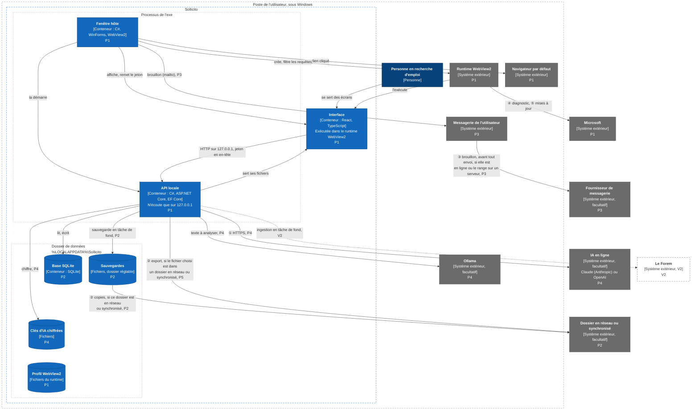
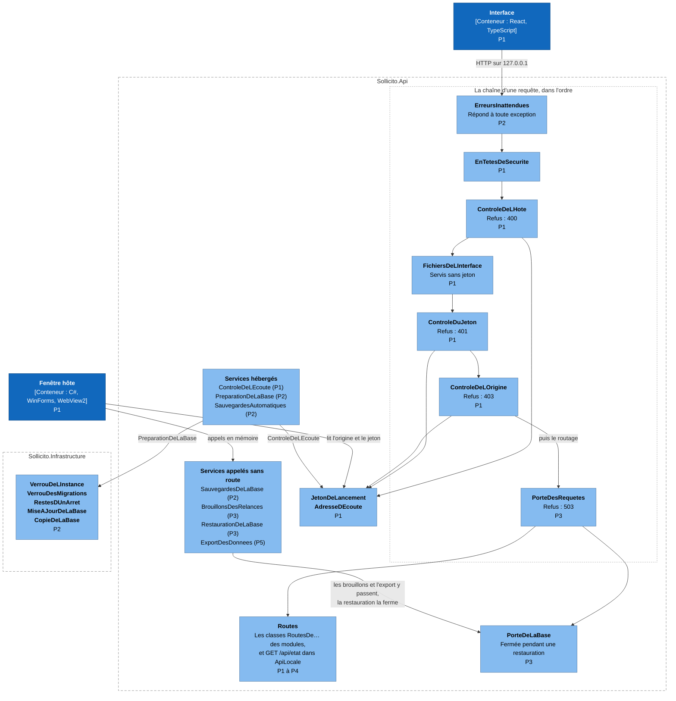
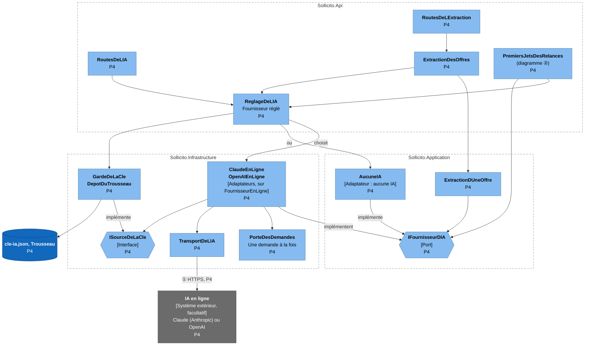
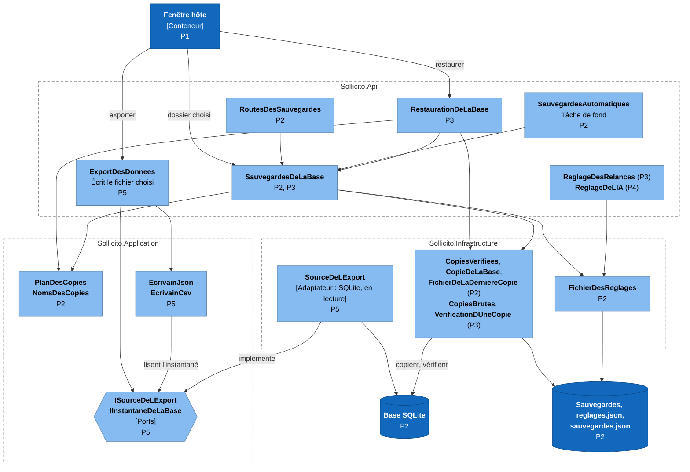

# Vues d'architecture de la V1

- **Mis à jour le** : 2026-11-28, avec #14, puis avec ses suites (#93), puis avec l'export de toutes les données (#49), puis avec la vue des composants (#59)
- **Décisions** : [ADR-0001](adr/0001-cadrage-architecture-v1.md) (D1 à D4, D6 à D10, D12), en partie remplacé par l'[ADR-0003](adr/0003-hote-interface-webview2.md) (hôte de l'interface) et l'[ADR-0004](adr/0004-v1-resserree-paliers.md) (V1 resserrée, livrée en paliers) ; [ADR-0006](adr/0006-requetes-et-liens-de-la-fenetre.md) (requêtes et liens de la fenêtre) ; [ADR-0008](adr/0008-sauvegardes-de-la-base.md) (sauvegardes de la base) ; [ADR-0011](adr/0011-relances-et-brouillon.md) (brouillon d'une relance) ; [ADR-0015](adr/0015-import-csv-des-offres.md) (import d'un fichier CSV et copie de la base avant lui) ; [ADR-0019](adr/0019-brouillon-de-relance-redige-par-l-ia.md) (texte relu d'un premier jet de l'IA) ; [ADR-0020](adr/0020-export-des-donnees.md) (export de toutes les données)
- **Périmètre** : la V1 que fixe l'ADR-0004, en trois vues du modèle C4 : le contexte (niveau 1), les conteneurs (niveau 2) et les composants de l'API locale (niveau 3). Les parcours clés, dans le temps : [diagrammes de séquence](diagrammes-de-sequence.md). Ce que l'utilisateur fait dans Sollicito : [cas d'utilisation](cas-d-utilisation.md).

Le modèle C4 ne prescrit pas de notation ; ces vues sont écrites en Mermaid, et chacune a sa légende. Les paliers sont ceux de l'ADR-0004 : P1, le squelette tourne ; P2, je suis mes candidatures ; P3, je relance et j'importe ; P4, mon IA m'aide ; P5, prêt à télécharger. L'avancement se suit dans les [jalons](https://github.com/moonn1000/sollicito/milestones).

## Vue de contexte

Où se place Sollicito : qui s'en sert, avec quels systèmes il échange, et ce qui quitte le poste.

| Légende | Sens |
| --- | --- |
| Boîte bleu foncé | la personne qui se sert de Sollicito |
| Boîte bleue | Sollicito, le système décrit |
| Boîte grise | un système extérieur : Sollicito s'en sert, mais ne le contient pas |
| Boîte blanche à bord pointillé | un système de la V2 |
| Cadre pointillé | la limite du poste de l'utilisateur |
| Trait plein, trait pointillé | un échange de la V1, un échange de la V2 |
| ① à ⑤ | les cinq échanges qui quittent le poste ; ② porte les copies de la base et les exports |
| P1 à P5 | le palier qui amène un élément ; sur un trait, celui qui amène l'échange, s'il vient après le palier 1 |

### Ce qui quitte le poste

Sollicito n'a pas de serveur distant. Seuls cinq échanges prévus franchissent la limite du poste, ceux que décrit le [README](../README.md) (« Ce qui quitte votre machine ») ; l'[ADR-0004](adr/0004-v1-resserree-paliers.md) (« Ce qui quitte la machine ») décrit le premier et les deux derniers, l'[ADR-0008](adr/0008-sauvegardes-de-la-base.md) et l'[ADR-0020](adr/0020-export-des-donnees.md) le deuxième, et l'[ADR-0011](adr/0011-relances-et-brouillon.md) le troisième :

1. ce que l'utilisateur confie à l'IA en ligne, Claude ou OpenAI, s'il en configure une (palier 4) ; un modèle Ollama, qui tourne sur le poste, ne fait rien sortir ;
2. les copies de la base et les exports, non chiffrés, si l'utilisateur range ses sauvegardes ou ses exports dans un dossier en réseau ou synchronisé (paliers 2 et 5) : ils partent là où ce dossier les envoie ;
3. le brouillon d'une relance, si la messagerie de l'utilisateur est en ligne ou range ses brouillons sur un serveur (palier 3) : son destinataire, son objet et son texte partent chez le fournisseur de messagerie, avant tout envoi ;
4. les données de diagnostic que le runtime WebView2 envoie à Microsoft ;
5. les mises à jour du runtime, qu'il télécharge seul.

Les deux derniers viennent du runtime, un composant de Windows, et non du code de Sollicito. Le Forem, en pointillé, n'arrive qu'en V2 (ADR-0004, « Ce qui attend la V2 »).

Le navigateur et la messagerie reçoivent sur le poste un lien ou un brouillon. Ce qu'ils en font ensuite ne vient pas de Sollicito : c'est l'utilisateur qui suit le lien ou envoie le message (ADR-0001, D8 ; ADR-0006). Une messagerie en ligne, ou qui range ses brouillons sur un serveur, reçoit pourtant le brouillon avant tout envoi : c'est l'échange ③.

Hors du diagramme :

- **GitHub Releases**, d'où l'on télécharge l'exe : Sollicito ne le contacte pas, puisqu'il n'a pas de mise à jour automatique (ADR-0004, D13).
- **En V2**, d'autres systèmes s'ajouteront : l'API du VDAB, la page d'une offre importée par son adresse, et Gmail ou Outlook, où déposer un brouillon sans l'envoyer, après son propre ADR (ADR-0004, « Ce qui attend la V2 »).

## Vue de conteneurs

De quoi Sollicito est fait. Tout tient dans un seul exe : la fenêtre hôte construit et démarre l'API locale dans son propre processus, et l'interface s'exécute dans les processus du runtime WebView2 (ADR-0003, « Montage »). Fermer la fenêtre arrête l'API.

| Légende | Sens |
| --- | --- |
| Boîte bleu foncé | la personne qui se sert de Sollicito |
| Boîte bleue | un conteneur de Sollicito ; en cylindre, des données |
| Boîte grise | un système extérieur |
| Boîte blanche à bord pointillé | un système de la V2 |
| Cadre pointillé gris | la limite du poste |
| Cadre pointillé bleu | la limite de Sollicito |
| Cadre en pointillé fin | un processus, ou un dossier |
| Trait plein, trait pointillé | un échange de la V1, un échange de la V2 |
| ① à ⑤ | les cinq échanges qui quittent le poste ; ② part du dossier des sauvegardes, ou de l'API pour un export, ③ de la messagerie |
| P1 à P5 | le palier qui amène un élément ; sur un trait, celui qui amène l'échange, s'il vient après le palier 1 |

### Les conteneurs

| Conteneur | Technologie | Responsabilités | Dans le dépôt | Palier |
| --- | --- | --- | --- | --- |
| Fenêtre hôte | C#, .NET 10, WinForms, contrôle WebView2 | construire et démarrer l'API, l'arrêter à la fermeture ; créer l'environnement du runtime et son profil ; remettre le jeton à l'interface ; annuler les navigations et retenir les requêtes hors de l'origine de l'interface ; ouvrir au-dehors un lien cliqué et, au palier 3, le brouillon d'une relance, dont le texte peut venir, au palier 4, du premier jet de l'IA relu par l'utilisateur (#47) ; au palier 2, ouvrir le dialogue de Windows qui choisit le dossier des sauvegardes (#26) ; au palier 3, demander dans son propre dialogue le oui d'une restauration, puis la lancer (#28) ; au palier 5, ouvrir le dialogue « Enregistrer sous » d'un export, puis le faire écrire par l'API (#49) | `src/Sollicito.Fenetre` | P1 (#13) |
| API locale | C#, ASP.NET Core, Kestrel, EF Core | écouter sur 127.0.0.1 seulement, sur un port choisi au lancement ; exiger le jeton, contrôler les en-têtes `Host` et `Origin` ; servir les fichiers de l'interface ; porter les règles des candidatures, puis des relances, des offres et de l'IA ; lire et écrire la base ; la sauvegarder, au palier 2, par une tâche de fond (voir « Tâches de fond ») ; au palier 3, la restaurer depuis une copie vérifiée, à la demande de la fenêtre seule, porte de la base fermée (#28) ; au palier 5, l'exporter dans le fichier que la fenêtre lui passe, en un seul instantané, à la demande de la fenêtre seule (#49) | `src/Sollicito.Api`, avec `src/Sollicito.Application`, `src/Sollicito.Domain` et `src/Sollicito.Infrastructure` | P1 (#10) |
| Interface | React, TypeScript, construite par Vite | les écrans ; garder le jeton en mémoire et l'envoyer dans son en-tête à chaque appel ; afficher tout texte échappé | `interface/` | P1 (#8, #13) |
| Base SQLite | SQLite, schéma par migrations EF Core | les données de l'utilisateur : six entités en base au terme de la V1 ([modèle de domaine](modele-de-domaine.md)) | migrations : `src/Sollicito.Infrastructure/Persistance/Migrations` | P2 (#11) |

L'API se découpe en couches (Clean Architecture) et en modules : Candidatures, Offres et connecteurs, Relances, IA (ADR-0004, D4). Le code y ajoute les contacts, les sauvegardes et la restauration, l'export et les réglages. Leur détail : la [vue des composants](#vue-des-composants).

### Les données

Les données vivent sous le profil de l'utilisateur, dans le dossier de données `%LOCALAPPDATA%\Sollicito`, hors du dossier de l'exe et hors du dépôt (ADR-0001, D10) :

- la base, `sollicito.db`, que l'API crée ou met à jour au lancement, avant d'écouter ;
- le profil du runtime WebView2, `WebView2\`, que la fenêtre fixe à la création de l'environnement ;
- au palier 2, les sauvegardes, par défaut dans `Sauvegardes\` (#26) : leur dossier se règle, et l'utilisateur peut le placer sur un autre support, puisqu'une copie sur le même disque ne protège pas de sa panne (ADR-0001, D10) ;
- au palier 3, ce qu'ajoutent la restauration (#28, ADR-0012) et l'import d'un fichier CSV (#40, ADR-0015) : dans le dossier des sauvegardes par défaut, la copie d'avant chaque restauration et chaque import, gardée hors de la rotation, et, pour la restauration, devant une base abîmée, sa copie brute, ses fichiers tels quels, gardée mais pas restaurable ; dans le dossier de données, le temps d'une restauration, la copie de travail `sollicito.db.<marque>.restauration`, où la copie choisie se vérifie. Les copies du jour d'une autre installation, rangées dans le même dossier, se restaurent aussi, sans compter dans la dernière copie ni dans la rotation ;
- au palier 2 aussi, les réglages de l'application, dans `reglages.json`, hors de la base, à commencer par le dossier des sauvegardes (#26) ;
- au palier 4, la clé d'IA, chiffrée par Data Protection dans `cle-ia.json`, et son trousseau, protégé par DPAPI en portée utilisateur, dans `Trousseau` (#43, ADR-0016) : hors de la base, ni les sauvegardes ni les exports ne les emportent.
- au palier 5, les exports (#49, ADR-0020), là où l'utilisateur les enregistre, jamais dans le dossier de données, qui est refusé : ils ne sont pas chiffrés, et, après un arrêt brutal, le fichier provisoire d'un export, `sollicito-export-<marque>.partiel`, peut rester à côté du fichier choisi ([format de l'export](export.md)).

Supprimer l'exe laisse toutes ces données en place (ADR-0004, « Conséquences »).

### Les échanges

- **La fenêtre et l'interface** : la page signale qu'elle est prête, la fenêtre vérifie la source du message et lui remet le jeton, qui ne vit qu'en mémoire ([modèle de menaces](modele-de-menaces.md), « Canal du jeton »).
- **L'interface et l'API** : l'API sert l'interface et ses routes à la même origine, `http://127.0.0.1:<port>`. L'interface l'appelle en HTTP, le jeton dans l'en-tête `Sollicito-Jeton`. L'API n'écoute sur aucune interface réseau, et refuse les appels des autres pages web, des autres appareils et des autres comptes du poste : jeton, `Host`, `Origin`. Un programme lancé sous le compte de l'utilisateur n'est arrêté par rien de cela ([modèle de menaces](modele-de-menaces.md), « Qui peut appeler l'API », « Protections de l'API locale » et « Limites »).
- **Les sorties de la fenêtre** : la fenêtre annule toute navigation et retient toute requête de la page vers une autre origine (ADR-0006). Seule la fenêtre ouvre au-dehors, par le shell de Windows, un lien `http` ou `https` cliqué par l'utilisateur (ADR-0006) et, au palier 3, le brouillon d'une relance, construit à partir de champs validés par l'API (ADR-0003, « Brouillon de relance ») ; au palier 4, son texte peut être celui du premier jet de l'IA, relu par l'utilisateur, que l'API revérifie avant l'ouverture (ADR-0019). Le détail et les limites : [modèle de menaces](modele-de-menaces.md), « Protections de la fenêtre » et « Limites ».
- **L'export** (palier 5) : la page le demande à la fenêtre par un message qui ne porte que le format ; la fenêtre ouvre le dialogue « Enregistrer sous » de Windows, puis passe le fichier choisi à l'API, en mémoire, qui lit la base et l'écrit. Aucune route ne reçoit un chemin, et la page ne reçoit que l'issue (ADR-0020).
- **L'IA** (palier 4) : c'est l'API, pas la page, qui appelle le fournisseur : chaque clé va à l'adresse officielle de son fournisseur, fixée dans le code, en HTTPS ; l'adresse d'Ollama se règle (ADR-0001, D7). Les adaptateurs de Claude et d'OpenAI (#48, ADR-0017) envoient par un transport à part, sans redirection ni nouvelle tentative, une demande à la fois, et seulement sur un geste de l'utilisateur.

### Tâches de fond

Comme l'ADR-0001 (D4) le veut pour l'ingestion des offres, une tâche de fond tourne dans le processus de l'API, sans conteneur à elle.

- **Aucun conteneur d'ingestion des offres.** L'ingestion en tâche de fond attend la V2, avec le Forem (ADR-0004, D4) : seul le trait pointillé « API locale → Le Forem » la représente.
- **La sauvegarde automatique** (palier 2) est une responsabilité de l'API. Son déclenchement relève de #26, qui l'a fixé ainsi : une minuterie, dans le processus de l'API, fait la copie au lancement et à la fermeture ; une fois par heure, elle fait la copie du nouveau jour et réessaie un dossier de sauvegarde manquant. L'[ADR-0008](adr/0008-sauvegardes-de-la-base.md) consigne ce choix.

## Vue des composants

De quoi l'API locale est faite (C4, niveau 3). Chaque boîte porte les noms que le code donne à ses classes ; les cadres sont les couches, c'est-à-dire les quatre projets .NET de l'API. L'interface et la fenêtre hôte y figurent comme conteneurs voisins : leur intérieur n'est pas décrit ici.

| Diagramme | Ce qu'il montre |
| --- | --- |
| [① Entrées de l'API](#-entrées-de-lapi) | les contrôles d'une requête dans leur ordre, ce que la fenêtre prend sans passer par une route, le démarrage |
| [② Candidatures, contacts et relances](#-candidatures-contacts-et-relances) | les candidatures, les contacts, les relances, leurs brouillons et le premier jet de l'IA |
| [③ Offres et connecteurs](#-offres-et-connecteurs) | le collage, l'import d'un fichier CSV, le dédoublonnage et « Postuler » |
| [④ IA](#-ia) | le fournisseur d'IA réglé, sa clé, l'extraction d'une offre et l'envoi en ligne |
| [⑤ Sauvegardes, restauration, export et réglages](#-sauvegardes-restauration-export-et-réglages) | les copies de la base, la restauration, l'export et le fichier des réglages |

Les diagrammes dessinent les classes qui portent un parcours : les contrôles, les routes, les cas d'usage, les ports, les adaptateurs, les services du démarrage et la tâche de fond. Les enregistrements, les valeurs et les classes d'aide n'y sont pas, ni les points d'accroche réservés aux tests, et les traits ne montrent pas tous les appels entre classes.

Les candidatures, les offres, l'IA et l'export passent par des ports de `Sollicito.Application`. Les sauvegardes, la restauration, les réglages et la garde de la clé n'ont pas de port, pas plus que la préparation de la base : les classes de l'API appellent directement les types de `Sollicito.Infrastructure`. L'ADR-0001 (D4) retient un monolithe modulaire en Clean Architecture, où le domaine ne dépend d'aucune infrastructure. L'interface `ISourceDeLaCle`, par laquelle les fournisseurs en ligne lisent la clé, est déclarée dans l'infrastructure.

### ① Entrées de l'API

| Légende | Sens |
| --- | --- |
| Boîte bleue | un conteneur voisin |
| Boîte bleu clair | un composant de l'API, ou plusieurs réunis |
| Cadre pointillé | une couche : un projet .NET |
| Cadre en pointillé fin | la chaîne des contrôles |
| Trait plein | un appel ; dans la chaîne, le passage au contrôle suivant |
| P1 à P5 | le palier qui amène un composant |

Un contrôle qui refuse répond aussitôt : la requête ne va pas plus loin. Les fichiers de l'interface ne passent ni le contrôle du jeton ni celui de l'origine. Une route marquée « sans la base » traverse la porte sans y entrer.

### ② Candidatures, contacts et relances

```mermaid
flowchart TB
    fenetre["<b>Fenêtre hôte</b><br>[Conteneur]<br>P1"]

    subgraph api["Sollicito.Api"]
        routescandidatures["<b>RoutesDesCandidatures</b><br><b>RoutesDesContacts</b><br>P2, P3"]
        routesrelances["<b>RoutesDesRelances</b><br>P3, P4"]
        premiersjets["<b>PremiersJetsDesRelances</b><br>P4"]
        brouillons["<b>BrouillonsDesRelances</b><br>P3, P4"]
        relus["<b>BrouillonsRelus</b><br>Texte relu, en mémoire<br>P4"]
        reglageia["<b>ReglageDeLIA</b><br>(diagramme ④)<br>P4"]
    end

    subgraph application["Sollicito.Application"]
        casdusage["<b>EnregistrementDesCandidatures</b><br><b>SuiviDesCandidatures</b><br><b>ModificationDesCandidatures</b><br>P2"]
        contacts["<b>ContactsDesEntreprises</b><br>P3"]
        relances["<b>RelancesDesCandidatures</b><br>P3"]
        regles["<b>BrouillonDeRelance</b> (P3)<br><b>PremierJetDeRelance</b> (P4)"]
        port{{"<b>IDepotDesCandidatures</b><br>[Port]<br>P2"}}
    end

    subgraph domaine["Sollicito.Domain"]
        entites["<b>Candidature, Entreprise</b> (P2)<br><b>Contact, Relance</b> (P3)"]
    end

    subgraph infra["Sollicito.Infrastructure"]
        depot["<b>DepotDesCandidatures</b><br><b>BaseDeSollicito</b><br>[Adaptateur : EF Core]<br>P2"]
    end

    base[("<b>Base SQLite</b><br>P2")]

    routescandidatures --> casdusage
    routescandidatures --> contacts
    routescandidatures -- "listes" --> port
    routesrelances --> relances
    routesrelances --> premiersjets
    routesrelances -- "passe le port<br>au dépôt du texte relu" --> port
    fenetre -- "brouillon d'une relance" --> brouillons
    premiersjets --> reglageia
    premiersjets --> regles
    premiersjets --> relus
    premiersjets --> port
    brouillons --> regles
    brouillons --> relus
    brouillons --> port
    casdusage --> port
    contacts --> port
    relances --> port
    casdusage --> entites
    contacts --> entites
    relances --> entites
    depot -- "implémente" --> port
    depot --> base

    classDef conteneur fill:#1168bd,stroke:#0b4884,color:#ffffff
    classDef composant fill:#85bbf0,stroke:#5d82a8,color:#000000
    class fenetre,base conteneur
    class routescandidatures,routesrelances,premiersjets,brouillons,relus,reglageia,casdusage,contacts,relances,regles,port,entites,depot composant
    style api fill:none,stroke:#888888,stroke-dasharray:6 4
    style application fill:none,stroke:#888888,stroke-dasharray:6 4
    style domaine fill:none,stroke:#888888,stroke-dasharray:6 4
    style infra fill:none,stroke:#888888,stroke-dasharray:6 4
```

| Légende | Sens |
| --- | --- |
| Boîte bleue | un conteneur voisin ; en cylindre, des données |
| Boîte bleu clair | un composant de l'API, ou plusieurs réunis |
| Hexagone | un port : une interface que l'application déclare |
| Cadre pointillé | une couche : un projet .NET |
| Trait plein | un appel ; « implémente », l'adaptateur qui réalise un port |
| P1 à P4 | le palier qui amène un composant |

Le délai par défaut des relances (`ReglageDesRelances`) figure au diagramme ⑤.

### ③ Offres et connecteurs

```mermaid
flowchart TB
    subgraph api["Sollicito.Api"]
        routes["<b>RoutesDesOffres</b><br><b>RoutesDeLImport</b><br>P3"]
        journal["<b>JournalDeLImport</b><br>[Adaptateur : journal]<br>P3"]
        sauvegardes["<b>SauvegardesDeLaBase</b><br>(diagramme ⑤)<br>P2, P3"]
    end

    subgraph application["Sollicito.Application"]
        connecteurs["<b>ConnecteurDuTexteColle</b><br><b>ConnecteurDuFichierCsv</b><br>[Adaptateurs de source]<br>P3"]
        portconnecteur{{"<b>IConnecteurDOffres</b><br>[Port]<br>P3"}}
        lecture["<b>LectureDUnFichierCsv</b><br>P3"]
        portimport{{"<b>IImportDesOffres</b><br>[Port]<br>P3"}}
        import["<b>ImportDesOffres</b><br>Empreinte et doublons<br>P3"]
        enregistrees["<b>OffresEnregistrees</b><br>P3"]
        enregistrement["<b>EnregistrementDesCandidatures</b><br>« Postuler » (diagramme ②)<br>P2, P3"]
        temoin{{"<b>ITemoinDeLImport</b><br>[Port]<br>P3"}}
        port{{"<b>IDepotDesOffres</b><br>[Port]<br>P3"}}
    end

    subgraph domaine["Sollicito.Domain"]
        entites["<b>Offre, EmpreinteDUneOffre</b> (P3)<br><b>Entreprise</b> (P2)"]
    end

    subgraph infra["Sollicito.Infrastructure"]
        depot["<b>DepotDesOffres</b><br><b>BaseDeSollicito</b><br>[Adaptateur : EF Core]<br>P2, P3"]
    end

    base[("<b>Base SQLite</b><br>P2")]

    routes --> connecteurs
    routes -- "lit le fichier" --> lecture
    routes --> portimport
    routes --> enregistrees
    routes -- "« Postuler »" --> enregistrement
    routes -- "copie avant l'import" --> sauvegardes
    connecteurs -- "implémentent" --> portconnecteur
    import -- "implémente" --> portimport
    import --> temoin
    journal -- "implémente" --> temoin
    import --> port
    enregistrees --> port
    import --> entites
    depot -- "implémente" --> port
    depot --> base

    classDef conteneur fill:#1168bd,stroke:#0b4884,color:#ffffff
    classDef composant fill:#85bbf0,stroke:#5d82a8,color:#000000
    class base conteneur
    class routes,journal,sauvegardes,connecteurs,portconnecteur,lecture,portimport,import,enregistrees,enregistrement,temoin,port,entites,depot composant
    style api fill:none,stroke:#888888,stroke-dasharray:6 4
    style application fill:none,stroke:#888888,stroke-dasharray:6 4
    style domaine fill:none,stroke:#888888,stroke-dasharray:6 4
    style infra fill:none,stroke:#888888,stroke-dasharray:6 4
```

| Légende | Sens |
| --- | --- |
| Boîte bleue en cylindre | des données |
| Boîte bleu clair | un composant de l'API, ou plusieurs réunis |
| Hexagone | un port : une interface que l'application déclare |
| Cadre pointillé | une couche : un projet .NET |
| Trait plein | un appel ; « implémente », la classe qui réalise un port |
| P2, P3 | le palier qui amène un composant |

Un connecteur fait d'une saisie ou d'un fichier des offres du modèle commun, que le cœur (`ImportDesOffres`) lit, dédoublonne et enregistre : le cœur ne dépend d'aucun connecteur. L'extraction d'une offre par l'IA est au diagramme ④.

### ④ IA

| Légende | Sens |
| --- | --- |
| Boîte bleue en cylindre | des données |
| Boîte bleu clair | un composant de l'API, ou plusieurs réunis |
| Boîte grise | un système extérieur |
| Hexagone | un port, ou une interface |
| Cadre pointillé | une couche : un projet .NET |
| Trait plein | un appel ; « implémente », la classe qui réalise un port ou une interface |
| ① | l'échange qui quitte le poste, numéroté comme dans la [vue de contexte](#vue-de-contexte) |
| P4 | le palier qui amène un composant |

Le fichier des réglages, où `ReglageDeLIA` écrit le fournisseur choisi, figure au diagramme ⑤.

### ⑤ Sauvegardes, restauration, export et réglages

| Légende | Sens |
| --- | --- |
| Boîte bleue | un conteneur voisin ; en cylindre, des données |
| Boîte bleu clair | un composant de l'API, ou plusieurs réunis |
| Hexagone | un port : une interface que l'application déclare |
| Cadre pointillé | une couche : un projet .NET |
| Trait plein | un appel ; « implémente », l'adaptateur qui réalise un port |
| P1 à P5 | le palier qui amène un composant |

La fenêtre appelle ces services en mémoire : aucune route ne reçoit un chemin (ADR-0008, ADR-0012, ADR-0020).
