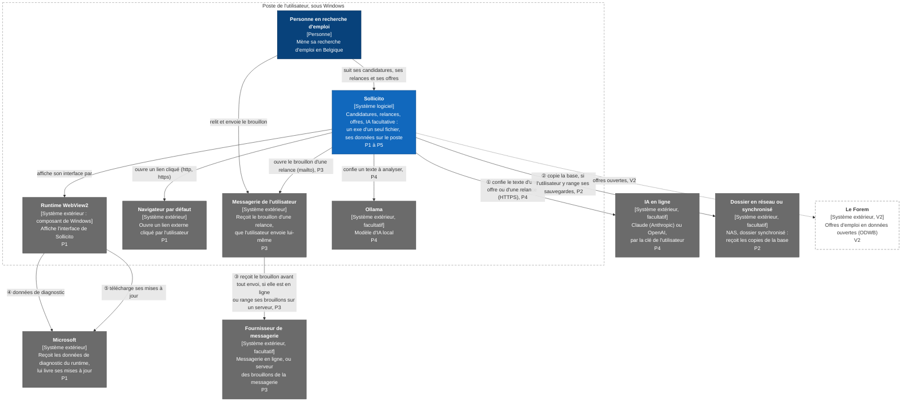
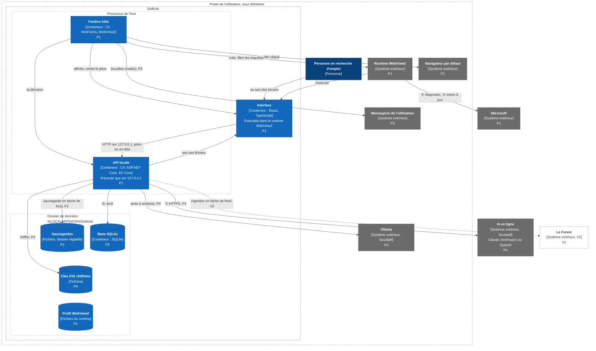

# Vues d'architecture de la V1

- **Mis à jour le** : 2026-11-21, avec #14
- **Décisions** : [ADR-0001](adr/0001-cadrage-architecture-v1.md) (D1 à D4, D6 à D10, D12), en partie remplacé par l'[ADR-0003](adr/0003-hote-interface-webview2.md) (hôte de l'interface) et l'[ADR-0004](adr/0004-v1-resserree-paliers.md) (V1 resserrée, livrée en paliers) ; [ADR-0006](adr/0006-requetes-et-liens-de-la-fenetre.md) (requêtes et liens de la fenêtre) ; [ADR-0008](adr/0008-sauvegardes-de-la-base.md) (sauvegardes de la base) ; [ADR-0011](adr/0011-relances-et-brouillon.md) (brouillon d'une relance)
- **Périmètre** : la V1 que fixe l'ADR-0004, en deux vues du modèle C4 : le contexte (niveau 1) et les conteneurs (niveau 2). La vue des composants (niveau 3) et les diagrammes de séquence s'y ajouteront au palier 5 (#59). Ce que l'utilisateur fait dans Sollicito : [cas d'utilisation](cas-d-utilisation.md).

Le modèle C4 ne prescrit pas de notation ; ces vues sont écrites en Mermaid, et chacune a sa légende. Les paliers sont ceux de l'ADR-0004 : P1, le squelette tourne ; P2, je suis mes candidatures ; P3, je relance et j'importe ; P4, mon IA m'aide ; P5, prêt à télécharger. L'avancement se suit dans les [jalons](https://github.com/moonn1000/sollicito/milestones).

## Vue de contexte

Où se place Sollicito : qui s'en sert, avec quels systèmes il échange, et ce qui quitte le poste.

| Légende | Sens |
| --- | --- |
| Boîte bleu foncé | la personne qui se sert de Sollicito |
| Boîte bleue | Sollicito, le système décrit |
| Boîte grise | un système extérieur : Sollicito s'en sert, mais ne le contient pas |
| Boîte blanche à bord pointillé | un système de la V2 |
| Cadre pointillé | la limite du poste de l'utilisateur |
| Trait plein, trait pointillé | un échange de la V1, un échange de la V2 |
| ① à ⑤ | les cinq échanges qui quittent le poste |
| P1 à P5 | le palier qui amène un élément ; sur un trait, celui qui amène l'échange, s'il vient après le palier 1 |

### Ce qui quitte le poste

Sollicito n'a pas de serveur distant. Seuls cinq échanges prévus franchissent la limite du poste, ceux que décrit le [README](../README.md) (« Ce qui quitte votre machine ») ; l'[ADR-0004](adr/0004-v1-resserree-paliers.md) (« Ce qui quitte la machine ») décrit le premier et les deux derniers, l'[ADR-0008](adr/0008-sauvegardes-de-la-base.md) le deuxième, et l'[ADR-0011](adr/0011-relances-et-brouillon.md) le troisième :

1. ce que l'utilisateur confie à l'IA en ligne, Claude ou OpenAI, s'il en configure une (palier 4) ; un modèle Ollama, qui tourne sur le poste, ne fait rien sortir ;
2. les copies de la base, non chiffrées, si l'utilisateur range ses sauvegardes dans un dossier en réseau ou synchronisé (palier 2) : elles partent là où ce dossier les envoie ;
3. le brouillon d'une relance, si la messagerie de l'utilisateur est en ligne ou range ses brouillons sur un serveur (palier 3) : son destinataire, son objet et son texte partent chez le fournisseur de messagerie, avant tout envoi ;
4. les données de diagnostic que le runtime WebView2 envoie à Microsoft ;
5. les mises à jour du runtime, qu'il télécharge seul.

Les deux derniers viennent du runtime, un composant de Windows, et non du code de Sollicito. Le Forem, en pointillé, n'arrive qu'en V2 (ADR-0004, « Ce qui attend la V2 »).

Le navigateur et la messagerie reçoivent sur le poste un lien ou un brouillon. Ce qu'ils en font ensuite ne vient pas de Sollicito : c'est l'utilisateur qui suit le lien ou envoie le message (ADR-0001, D8 ; ADR-0006). Une messagerie en ligne, ou qui range ses brouillons sur un serveur, reçoit pourtant le brouillon avant tout envoi : c'est l'échange ③.

Hors du diagramme :

- **GitHub Releases**, d'où l'on télécharge l'exe : Sollicito ne le contacte pas, puisqu'il n'a pas de mise à jour automatique (ADR-0004, D13).
- **En V2**, d'autres systèmes s'ajouteront : l'API du VDAB, la page d'une offre importée par son adresse, et Gmail ou Outlook, où déposer un brouillon sans l'envoyer, après son propre ADR (ADR-0004, « Ce qui attend la V2 »).

## Vue de conteneurs

De quoi Sollicito est fait. Tout tient dans un seul exe : la fenêtre hôte construit et démarre l'API locale dans son propre processus, et l'interface s'exécute dans les processus du runtime WebView2 (ADR-0003, « Montage »). Fermer la fenêtre arrête l'API.

| Légende | Sens |
| --- | --- |
| Boîte bleu foncé | la personne qui se sert de Sollicito |
| Boîte bleue | un conteneur de Sollicito ; en cylindre, des données |
| Boîte grise | un système extérieur |
| Boîte blanche à bord pointillé | un système de la V2 |
| Cadre pointillé gris | la limite du poste |
| Cadre pointillé bleu | la limite de Sollicito |
| Cadre en pointillé fin | un processus, ou un dossier |
| Trait plein, trait pointillé | un échange de la V1, un échange de la V2 |
| ①, ④, ⑤ | trois des cinq échanges qui quittent le poste ; ② part du dossier des sauvegardes, ③ de la messagerie (voir la vue de contexte) |
| P1 à P5 | le palier qui amène un élément ; sur un trait, celui qui amène l'échange, s'il vient après le palier 1 |

### Les conteneurs

| Conteneur | Technologie | Responsabilités | Dans le dépôt | Palier |
| --- | --- | --- | --- | --- |
| Fenêtre hôte | C#, .NET 10, WinForms, contrôle WebView2 | construire et démarrer l'API, l'arrêter à la fermeture ; créer l'environnement du runtime et son profil ; remettre le jeton à l'interface ; annuler les navigations et retenir les requêtes hors de l'origine de l'interface ; ouvrir au-dehors un lien cliqué et, au palier 3, le brouillon d'une relance ; au palier 2, ouvrir le dialogue de Windows qui choisit le dossier des sauvegardes (#26) ; au palier 3, demander dans son propre dialogue le oui d'une restauration, puis la lancer (#28) | `src/Sollicito.Fenetre` | P1 (#13) |
| API locale | C#, ASP.NET Core, Kestrel, EF Core | écouter sur 127.0.0.1 seulement, sur un port choisi au lancement ; exiger le jeton, contrôler les en-têtes `Host` et `Origin` ; servir les fichiers de l'interface ; porter les règles des candidatures, puis des relances, des offres et de l'IA ; lire et écrire la base ; la sauvegarder, au palier 2, par une tâche de fond (voir « Tâches de fond ») ; au palier 3, la restaurer depuis une copie vérifiée, à la demande de la fenêtre seule, porte de la base fermée (#28) | `src/Sollicito.Api`, avec `src/Sollicito.Application`, `src/Sollicito.Domain` et `src/Sollicito.Infrastructure` | P1 (#10) |
| Interface | React, TypeScript, construite par Vite | les écrans ; garder le jeton en mémoire et l'envoyer dans son en-tête à chaque appel ; afficher tout texte échappé | `interface/` | P1 (#8, #13) |
| Base SQLite | SQLite, schéma par migrations EF Core | les données de l'utilisateur : six entités en base au terme de la V1 ([modèle de domaine](modele-de-domaine.md)) | migrations : `src/Sollicito.Infrastructure/Persistance/Migrations` | P2 (#11) |

L'API se découpe en couches (Clean Architecture) et en modules : Candidatures, Offres et connecteurs, Relances, IA (ADR-0004, D4). Leur détail est l'affaire de la vue des composants (#59).

### Les données

Les données vivent sous le profil de l'utilisateur, dans le dossier de données `%LOCALAPPDATA%\Sollicito`, hors du dossier de l'exe et hors du dépôt (ADR-0001, D10) :

- la base, `sollicito.db`, que l'API crée ou met à jour au lancement, avant d'écouter ;
- le profil du runtime WebView2, `WebView2\`, que la fenêtre fixe à la création de l'environnement ;
- au palier 2, les sauvegardes, par défaut dans `Sauvegardes\` (#26) : leur dossier se règle, et l'utilisateur peut le placer sur un autre support, puisqu'une copie sur le même disque ne protège pas de sa panne (ADR-0001, D10) ;
- au palier 3, ce qu'ajoute la restauration (#28, ADR-0012) : dans le dossier des sauvegardes par défaut, la copie d'avant chaque restauration, gardée hors de la rotation, et, devant une base abîmée, sa copie brute, ses fichiers tels quels, gardée mais pas restaurable ; dans le dossier de données, le temps d'une restauration, la copie de travail `sollicito.db.<marque>.restauration`, où la copie choisie se vérifie. Les copies du jour d'une autre installation, rangées dans le même dossier, se restaurent aussi, sans compter dans la dernière copie ni dans la rotation ;
- au palier 2 aussi, les réglages de l'application, dans `reglages.json`, hors de la base, à commencer par le dossier des sauvegardes (#26) ;
- au palier 4, la clé d'IA, chiffrée par Data Protection dans `cle-ia.json`, et son trousseau, protégé par DPAPI en portée utilisateur, dans `Trousseau` (#43, ADR-0016) : hors de la base, ni les sauvegardes ni les exports ne les emportent.

Supprimer l'exe laisse toutes ces données en place (ADR-0004, « Conséquences »).

### Les échanges

- **La fenêtre et l'interface** : la page signale qu'elle est prête, la fenêtre vérifie la source du message et lui remet le jeton, qui ne vit qu'en mémoire ([modèle de menaces](modele-de-menaces.md), « Canal du jeton »).
- **L'interface et l'API** : l'API sert l'interface et ses routes à la même origine, `http://127.0.0.1:<port>`. L'interface l'appelle en HTTP, le jeton dans l'en-tête `Sollicito-Jeton`. L'API n'écoute sur aucune interface réseau, et refuse les appels des autres pages web, des autres appareils et des autres comptes du poste : jeton, `Host`, `Origin`. Un programme lancé sous le compte de l'utilisateur n'est arrêté par rien de cela ([modèle de menaces](modele-de-menaces.md), « Qui peut appeler l'API », « Protections de l'API locale » et « Limites »).
- **Les sorties de la fenêtre** : la fenêtre annule toute navigation et retient toute requête de la page vers une autre origine (ADR-0006). Seule la fenêtre ouvre au-dehors, par le shell de Windows, un lien `http` ou `https` cliqué par l'utilisateur (ADR-0006) et, au palier 3, le brouillon d'une relance, construit à partir de champs validés par l'API (ADR-0003, « Brouillon de relance »). Le détail et les limites : [modèle de menaces](modele-de-menaces.md), « Protections de la fenêtre » et « Limites ».
- **L'IA** (palier 4) : c'est l'API, pas la page, qui appelle le fournisseur : chaque clé va à l'adresse officielle de son fournisseur, fixée dans le code, en HTTPS ; l'adresse d'Ollama se règle (ADR-0001, D7). Les adaptateurs de Claude et d'OpenAI (#48, ADR-0017) envoient par un transport à part, sans redirection ni nouvelle tentative, une demande à la fois, et seulement sur un geste de l'utilisateur.

### Tâches de fond

Comme l'ADR-0001 (D4) le veut pour l'ingestion des offres, une tâche de fond tourne dans le processus de l'API, sans conteneur à elle.

- **Aucun conteneur d'ingestion des offres.** L'ingestion en tâche de fond attend la V2, avec le Forem (ADR-0004, D4) : seul le trait pointillé « API locale → Le Forem » la représente.
- **La sauvegarde automatique** (palier 2) est une responsabilité de l'API. Son déclenchement relève de #26, qui l'a fixé ainsi : une minuterie, dans le processus de l'API, fait la copie au lancement et à la fermeture ; une fois par heure, elle fait la copie du nouveau jour et réessaie un dossier de sauvegarde manquant. L'ADR-0008, qui arrive avec #26, consignera ce choix.
